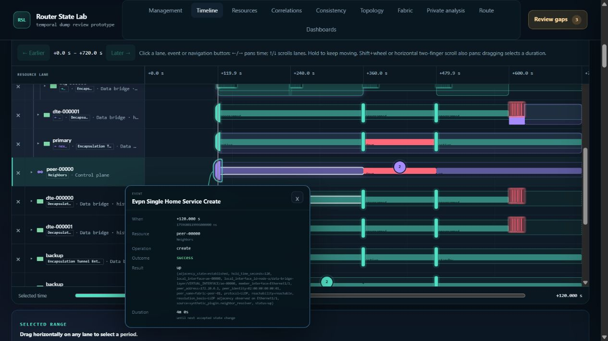

# Browser audit continuation — 22 October 2026

All 200 continuation case IDs now have recorded and independently reviewed
outcomes. **168 passed with explicit evidence limits, 20 are inconclusive, and
12 are blocked.** This is not a claim that all 200 combinations passed or that
every assertion in a qualified case was exercised. No new functional defect was
confirmed. One substantial performance cost was observed: opening a cold full
member history took about 47 seconds.

The original 600-case plans had 436 completed IDs and **164 remaining**, rather
than 200. This run covered those 164 IDs and 36 explicitly identified supplemental
sequences. The older 27 reported defects were not counted again as new findings.

## Reproducible record

- [Case index](case-index.csv): one row per ID, outcome, source and limitations.
- [Detailed ledger](case-ledger.json): original actions/assertions, verified
  observations, unverified assertions, raw JSONL line/hash references and
  adjudications for every case.
- [Evidence archive](evidence.zip): raw attempts, original continuation plans,
  independent reviews, browser helper scripts, passive measurements and logs.
  Extract it before resolving the relative evidence paths in the ledger.
- [Performance summary](performance-summary.json) and
  [final browser state](handoff-state.json).
- [File integrity manifest](manifest.json).

Nineteen superseded attempts remain in the evidence but do not add coverage.
One idless attempt is excluded. The reviewed ledger takes precedence over the
raw attempt notes where later inspection narrowed or corrected a conclusion.

The tested revision was `de05a522bb5bf222c132cb6911b587561e5a8ff0`, on
`codex/comprehensive-router-dump-demo`. Browser actions used the in-app browser
against `http://127.0.0.1:8883`, including the ten-member fabric and the full
node-a workspace: 1,250,005 normalized events and 7,510 resources. All interaction
was through browser controls; DOM reads supplied identity, geometry and state
evidence. Source inspection explained observations but did not substitute for
browser execution. Review markers used the browser-only scope and were removed.

## Findings

### PERF-01 — cold member navigation materializes a complete history

In M279, open the transit scenario, select the actual P1 hop, and enter its node
workspace after another member is loaded. The first cold `transit-p-1` navigation
ran from 19:00:28.690 to 19:01:15.687 UTC: **46.997 seconds from action to observed
completion**, with **44.203–47.359 server CPU seconds** in the bracketing samples.
This span includes initialization and subsequent frontend requests; it is not a
parse-only or single-request latency measurement.

RSS was about 3.110 GiB before the transition, peaked at 3.219 GiB, fell to
1.113 GiB as the old materialization was evicted, and reached 2.717 GiB at the
completion sample. The demo retains one fully materialized member dataset. A
cold member validates its prepared archive, frees an idle prior dataset, then
parses and indexes the selected history. The outer assembly is reused; this
does not rebuild all ten members. See
`performance/transit-navigation-snapshot-1/analysis.json` in the archive for the
samples, response-log bracket and source mapping to `session.py`,
`assembly_store.py`, `scale_data.py` and `runtime_api.py`.

This is an observed navigation cost, not a demonstrated regression or leak.
The evidence points to the cold full-history materialization path as the next
optimization target; no implementation change was made in this audit.

### No confirmed new functional failures

The recorded successful workflows include repeated lane removal/restoration,
duplicate resource paths, normalized/source jumps, source and review lanes with
zero resource lanes, keyboard popup activation, range validation, bundle time
changes, dashboard lifecycle, explicit topology basis, route/fabric history and
three complete cross-component loops. Examples with direct evidence:

- C014 retained a source popup with **9.57 pixels** of its marker visible below
  the sticky header, dismissed it on full clipping and did not revive it on
  ordinary scrollback.
- C018 loaded exact normalized pages **100 → 107** by keyboard, then loaded all
  **104 events** in the rebinned model.
  Changing a preceding lane changed the cluster binning; the reopened card used
  the new model. C019 preserved all 104 UID/time pairs and correct per-row range
  suffixes through partial range, Clear and outside range.
- C022 rejected malformed range input while preserving the previously applied
  range. C023 retained a one-nanosecond range and exact source identity through
  zoom, Fit and Back. That source was 30 seconds from the capture start, not at
  the exact endpoint.
- C036 repeated Timeline → Log → Resources → Dashboards → Topology → Timeline
  three times with the same event and restored lane. Final snapshots showed
  14 roots, three source lanes, one popup element and no sampled busy indicator.

These examples do not remove the case-specific limits in the ledger.

## Remaining evidence gaps and corrected interpretations

The 12 blocked cases require Escape while a pointer remains held during a brush.
The documented browser interface exposes an atomic drag, without an interleaved
pointer-down/Escape/pointer-up sequence. Those gestures were not executed.

The 20 inconclusive cases include races without observed pending overlap, native
drag/reorder attempts without proven event delivery, a kind switch unavailable
under a no-match filter, and passive-focus cases without an observed row
replacement or asynchronous completion. Recovery succeeding does not prove the
unobserved branch.

Additional limits retained in qualified cases include:

- Some range-form operations scrolled the popup anchor fully away. They test
  dismissal/reopening and retained data, not uninterrupted card scroll/focus.
- The log had no horizontal overflow in C017. Its unpinned hover cards do not
  establish pinned-card revival behavior or horizontal clipping.
- Review-cluster child buttons select the inspector/cursor; Ctrl-clicking those
  children does not promise a log jump. The actual review glyph supplies that
  navigation. Unchanged search after a child click was not a defect.
- Cluster IDs can change when lane count redistributes the glyph budget. This
  was expected rebinning, not resource identity loss.
- Unpinned All paths mode intentionally hides selected-path details. Retained
  hidden text was not treated as a visible stale result or a stuck request.
- M291 and M297 were retried after waiting for the actual loaded node banner
  and Back link. Early automation return was not counted as a context-loss bug.
  Latest M291 and M292–M300 used best-effort clock policy, so they do not supply
  the original plan's Strict-clock baseline coverage.
- Dashboard module counts stayed coherent, but C028 did not restore the exact
  baseline order within its sequence. A separate final restoration did; the
  handoff record contains the resulting order. C029's unchanged point-in-time
  population was zero, so it does not prove preservation of a nonempty sample.
- Several rapid pointer activations needed a settled-state or keyboard retry.
  Missing activation alone did not establish a product cancellation defect.
  Restricted process enumeration also falsely suggested the server was absent;
  exact-process checks confirmed it remained alive. No server crash is reported.

## Performance observations and limits

| Observation | Result |
| --- | --- |
| Final server RSS | 3.105 GiB |
| Highest sampled / final lifetime peak RSS | 3.219 GiB |
| Separate final quiet sample | 36.031 seconds |
| CPU during that quiet sample | 1.3125 seconds, about 3.64% of one core |
| RSS during that quiet sample | Constant |
| Measured response-log prefix | 6,272 HTTP 200 responses; no logged HTTP errors |
| stderr growth | Zero; startup file remained 117 bytes |

Process samples were nominally two seconds apart. The observer handoff had a
28-second overlap, accounted for without summing duplicate CPU intervals. A
**306.344-second sampling gap, 20:14:21–20:19:27 UTC**, remains explicit: the
second observer stopped writing without a completion marker. CPU endpoints
across that gap are known, but intermediate memory and per-action attribution
are not. C036 loops 2/3 and its first idle interval fall in this gap. The final
36-second quiet sample was collected afterward and is a separate observation.

C036's 25 action-to-observation timings ranged from 4.109 to 7.368 seconds. They
include automation and accessibility sampling, so they are **not application
latency measurements**. Process-wide CPU is not browser CPU or function-level
attribution. Sampled RSS may miss brief transients. Initial-to-final growth spans
loading and member changes and does not establish a leak. No controlled 1M
benchmark or frontend test suite was rerun for this audit-only request.

## Handoff

The original server remains running; passive observers are stopped. The final
view shows the exact event `node-a/scale-event-00000000` at +120 seconds.
The 14 resource roots and original dashboard ordering are restored, and no
audit review markers remain. Three source lanes remain visible, including the
temporary jump lane used by the audit.

Only audit documentation/evidence was added. Plug-in documentation drift check
completed: no public plug-in behavior, example, author command or maintained
authoring material changed, so no skill/contract/quickstart update was required.
No product fixes, commit or push were performed.
