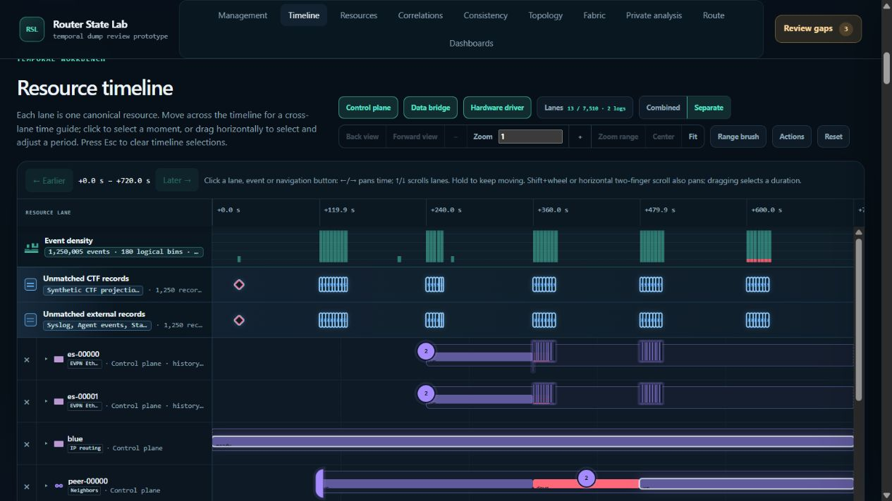

# Unresolved browser-audit follow-up — 2026-10-22

All **32 previously unresolved cases** now have additional verification. No new
product bug was confirmed. This does **not** mean all 32 original scenarios
passed in the native browser: the evidence and remaining limits differ by case.
The [prior audit](../audit-200-continuation-2026-10-22/README.md) is unchanged.

| Cases | Count | Follow-up evidence and outcome |
|---|---:|---|
| S232, S238, S273, S279, S285, S291, S297, C010–C012, C030 | 11 | Live browser requests were deliberately held across newer actions. Cancellation and current results behaved correctly. Controlled tests additionally proved rejection of late responses that ignore abort. C030's full three-action overlap is controlled-only. |
| S244, S254, S264 | 3 | Native dashboard drags changed order; subsequent Move up/down recovery worked. Controlled drag handlers also passed. |
| S246, S256, S266, C029 | 4 | A reachable revised sequence preserved nonempty dashboard contents through no-match filtering and close/reopen, then recovered after clearing the filter and switching kind. The original kind-before-clear step remains unavailable. |
| C015, C016 | 2 | Browser scroll/recovery and delayed graph completion passed. Density node replacement identity and delayed detail completion remain controlled-test evidence. |
| S094–S095, S099–S100, S104–S105, S109–S110, S114–S115, S119–S120 | 12 | Production pointer/Escape/cancellation handlers passed with exact saved bounds and deferred summaries. The browser tool cannot insert Escape during its atomic held-button drag; native gesture delivery remains unverified. |

The [32-case ledger](case-ledger.json) preserves original assertions, exact
browser-record references, request gates, controlled checks and remaining limits.
[Evidence archive](evidence.zip) and [hash manifest](evidence-manifest.json)
preserve the underlying observations and test logs.

## What the browser replay established

The audit proxy on port 8884 forwarded unmodified responses from the existing
demo on port 8883. It held one selected response until explicitly released.
This established real pending overlap instead of inferring it from rapid action
order. All twelve gates were explicitly released; none reached its 90-second
fails-open limit.

For the eleven obsolete-query cases, release logged `client-disconnected`:
native cancellation had closed the old request. This proves cancellation and
retention of the latest result, **not delivery of an obsolete body after abort**.
The separate controlled tests deliberately ignore abort and finish obsolete
successes/errors to verify the remaining ownership guards. Only the C016 graph
gate delivered its held response to the browser.

- Five route cases retained the selected route, returned attribution and branch
  result after obsolete release. These are node-local projections, not a new
  end-to-end forwarding audit.
- S232 retained the newer empty VIRTUAL_INTERFACE result under its peer search;
  clearing the search restored populated rows. S238 retained two MPLS_BINDING
  rows and their schema.
- C010 preserved the chosen Back window after release and recovered with an
  explicit create-event reveal. C011 retained the delete event at +210 seconds
  after Fit and the newer reveal. C012 kept the target lane absent after hide,
  then restored its delete-event marker through an explicit reveal.
- C030's browser sequence was settled DTE → held search → NEIGHBOR dashboard
  selection. The full search → pending kind change → dashboard selection is
  verified in controlled tests, in both kind directions. The saved browser
  `selectedDetails` field captured the event inspector, so it is not evidence
  of the resource inspector; the current resource table and clicked identity
  are recorded separately.
- C016 preserved nested/document scroll and a hidden popup when the held graph
  response completed; intentional reveal still worked. The detail response had
  already completed before clipping. Controlled tests cover delayed detail and
  both completion orders.
- C015 retained a dismissed popup after scrolling the focused density bin away
  and reopened it on intentional focus. Native replacement identity was not
  instrumented; its production replacement/focus-repair branch passed in the
  controlled test.

The no-match scenarios exposed an invalid original precondition: zero matching
resources leave only the selected flat kind tab available. The revised sequence
clears that filter before choosing DTE. A recorded `sameModules: true` comparison
at a nonempty baseline confirms dashboard contents survived filtering/reopening.
This is a verified recovery path, not a claim that the unavailable original
step was performed.

## Validation and limitations

Three new focused files add **46 passing tests**:

```powershell
node --test frontend/tests/audit_brush_focus_followup.test.mjs frontend/tests/audit_drag_filter_followup.test.mjs frontend/tests/audit_request_races_followup.test.mjs
npm --prefix frontend run check
```

The complete frontend check passed **601/601**. An earlier sandboxed run had
590 passes and 11 local-network `EACCES` failures; the unchanged suite passed
after local network access was available. Both logs are archived.

Controlled tests use production handlers with bounded DOM, transport and
geometry substitutes. They do not establish native gesture delivery or full
browser layout. Browser captures preserve final identity and popup state but
do not record every marker rectangle or intermediate frame. Artificial holds
and automation timings are not product latency measurements; this follow-up
did not run a new 1M memory/CPU benchmark.

The initial proxy was GET-only and returned 501 for POST; its forwarding was
corrected before gated verification. Connection recovery, an automation-loop
timeout, and initial missing/misnamed test-fixture fields were harness issues,
not confirmed application bugs. Earlier unchanged-order drag attempts remain
in the evidence alongside the successful retries.

No product code changed. The plug-in documentation drift check found no public
API, author-command or example changes, so maintained authoring documents did
not require updates. The conformance declaration inventory also passed.

## Evidence and cleanup

The archive contains 59 browser snapshots, request-gate records, the audit
proxy/sampler source, agent reports, test logs and representative screenshots.
Only repetitive `/v1/analysis-load` polling records were omitted from the proxy
copy; all other records remain with their original `source_line`. The manifest
records the original proxy hash and the exact filtering rule. Browser record
line numbers refer to `browser.jsonl` inside the archive; gate references use
`source_line` in `proxy-evidence.jsonl`.

The browser was restored to the original demo on port 8883. Only the verified
audit proxy process was stopped; the existing demo server remained running.


