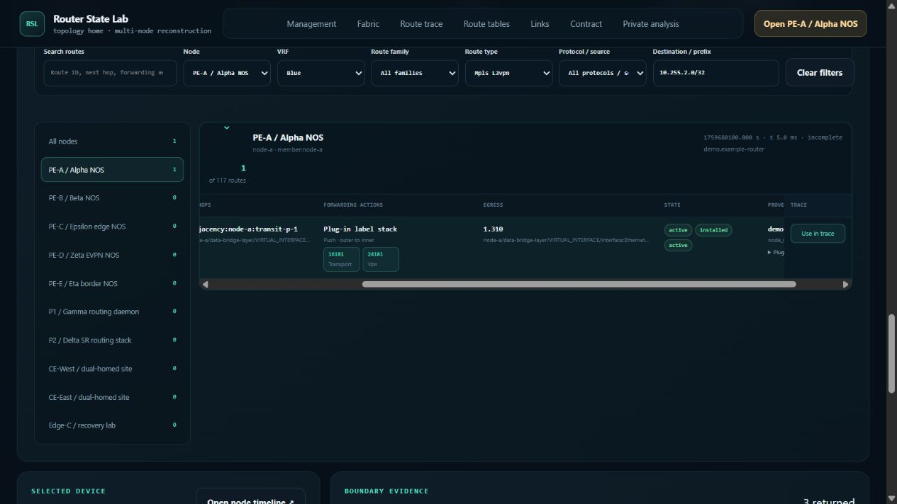
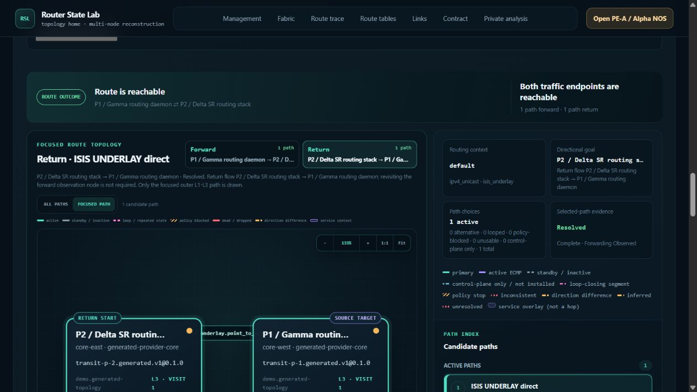
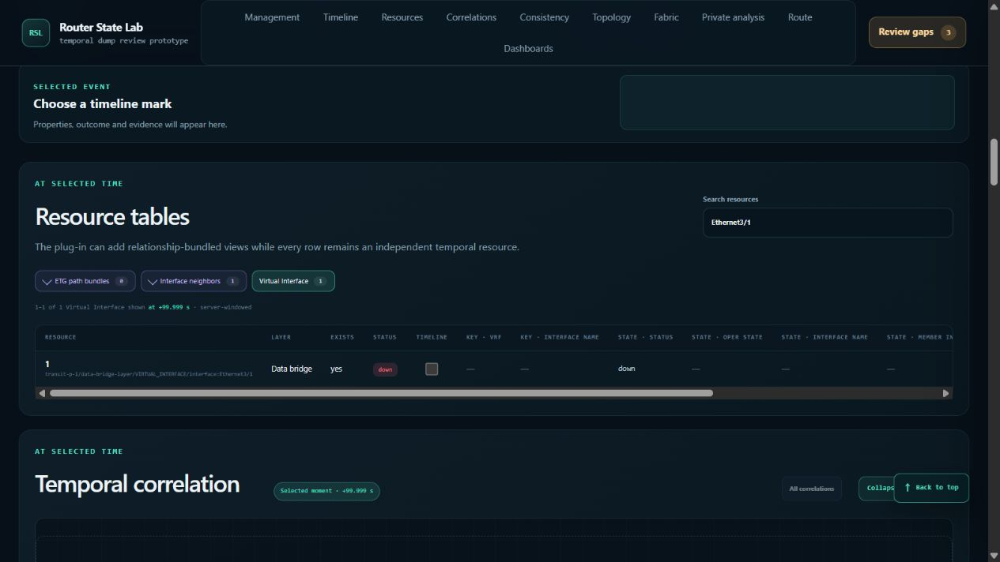
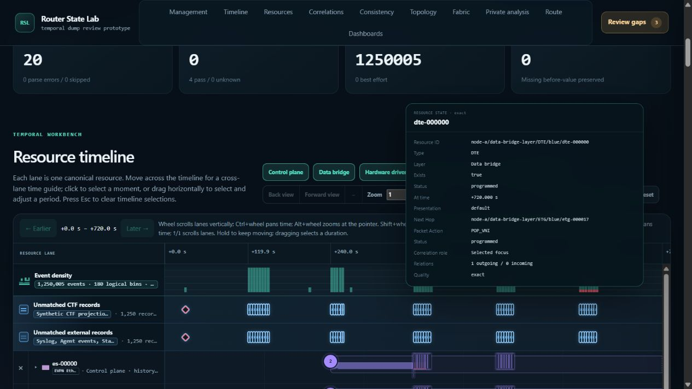
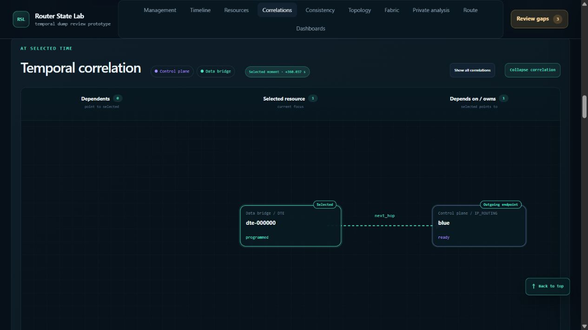

# Historical route and resource-correlation browser audit

Date: 2026-10-23. **100 additional browser moves executed and recorded.**
The scope was historical status reconstruction in route trace and temporal
resource-correlation correctness in the single-node workspace. No product code
was changed in this audit.

There are **three confirmed functional defects**, one performance observation
requiring profiling, and one inconclusive log-navigation observation. The 100
moves are a stateful exploration sequence, not 100 independent passing tests.
Pending results, adaptations to the plan, and limits are recorded explicitly.

## Reproduction environment and evidence

- Local demo: `http://127.0.0.1:8883`, existing offline synthetic audit workspace.
- Branch: `codex/comprehensive-router-dump-demo`; HEAD:
  `f8f5de77a5124a12317f9e71d23b4a5f7562df25`, plus the pre-existing uncommitted
  VPN popup repair. Those changes were preserved.
- Fixture: `demo/fixtures/router-state-lab-algorithms-2026-10-02.tgz`.
  SHA-256: `4cea20db78aa3fede9dc79a89a9277c5a9a72905fbff76a5f8436efd1c4aec30`.
- PE-A contains 1,250,005 normalized events and 7,510 resources. This is the
  generated full-scale fixture, not a validated production capture.
- Route offsets below are relative to UTC `1759680000000000000` ns
  (2025-10-05 16:00:00 UTC). Single-node PE-A offsets use its native capture
  origin `1759679999996000000` ns. Clock bounds must be considered when comparing
  the two views.
- The parent agent operated the browser through its UI. Two supporting agents
  inspected fixture/source expectations and reviewed saved browser evidence;
  their reviews are not claimed as independent browser executions.

Read the [100-move ledger](moves.md), [original plan](plan.json), and
[machine-readable execution log](moves.json). The [evidence archive](evidence.zip)
contains all 100 numbered DOM snapshots, settled supplements, exact-time repeat
results, and fixture/source reviews. [SHA-256 manifest](evidence-sha256.json)
identifies the archived files. Screenshots below are also stored separately.

## HC-01 — Historical route view accepts future route evidence

**Priority: P1.** The view can assert a reachable past route using a route row
whose own validity begins later than the selected instant.

Reproduce:

1. In Fabric, apply absolute time `1759680100000000000` ns (+100 s), best effort.
2. In PE-A's route table, inspect blue / `vpnv4_unicast` / `mpls_l3vpn` toward
   `10.255.2.0/32` (PE-B).
3. Use that row in the trace and run it. Inspect both directions and all paths.

Observed: the table shows the row active and installed; the completed trace
says **Route is reachable** and **Both traffic endpoints are reachable**, with
A → P1 → B resolved. The exact row is
`node-a/route/inventory/generic-mpls_l3vpn-blue-vpnv4_unicast/node-b`.
Its fixture `observed_at_ns` is `1759680600996000000`, +600.996 s. The core
normalizer uses that as `valid_from_ns`, **500.996 seconds after the selected
historical instant**. This difference is far outside clock uncertainty.

Expected: an out-of-validity row must not supply established historical
reachability. It should be excluded or explicitly unavailable/unknown under
the selected basis; no earlier state should be invented.

Source cause: `_generated_route_table_entry` publishes row validity in
`src/router_dump_analyzer/multi_node_route.py:4339–4340`, but the `route_tables`
loop at `:5153–5207` checks only the global topology start before appending the
unchanged row under the new basis. It never checks the row's validity interval.
The capability declares time-bound queries and core owns time-context filtering.
The table and trace are counted as two manifestations of this one historical
validity problem, not two separate bugs.

Evidence: moves 012–015; `future-row.txt`, `013.txt`, `route-oracle.md`, and
`route-review.md` in the archive. The exact later timestamp was independently
read from the immutable fixture; the saved accessibility snapshot does not
include the expanded plugin JSON.

## HC-02 — Typed point-to-point link ignores historical carrier loss

**Priority: P1.** A direct route remains resolved through a link whose local
interface is down at the same historical context.

Reproduce:

1. Apply absolute +100 s and trace P1 → P2 using ISIS underlay.
2. Inspect the direct point-to-point segment and the Return direction.
3. Repeat +100 s → +241 s → +100 s, letting each result settle.
4. Open P1's single-node workspace from the +100 s context. Find virtual
   interface `Ethernet3/1` and compare its historical status.

Observed: all three completed route results report both endpoints reachable;
the typed `p1-p2-sr` link remains usable. In P1's local view, Ethernet3/1 is
**down** at the corresponding historical context. The fixture records a
successful carrier-down event at +90.05 s and restoration at +240.1 s.
The circuit is P1 Ethernet3/1 ↔ P2 Ethernet4/1, `10.64.255.0/31`; the direct
trace actually crosses it. This avoids the false inference that merely having
P1 and P2 on separate parallel paths exercises their mutual circuit.

Expected: historical local carrier status must affect the declared link's
usability and the route outcome. The selected time must reach the state provider.

Source cause: `demo/rsl_demo_plugin/typed_topology.py:460–489` builds states from
initial raw claims. Its state provider at `:302–306` discards `resolved_time`,
and `_claim_state` at `:309–358` retains the initial usable status. Projection
then derives usability from those frozen states. The legacy connectivity-domain
path does replay resource changes, explaining why the PE-D deletion control
correctly became unresolved while this typed circuit did not.

Evidence: moves 047–049; `p1-p2-repeat.json`, `p1-local-interface.txt`, and
`route-review.md` in the archive. The local P1 screenshot is additional parent
verification performed after the supporting route review.

## HC-03 — Pinned correlation card survives off-screen anchor and blocks Actions

**Priority: P2.** A pinned resource card remains over unrelated page controls
after its graph anchor scrolls away.

Reproduce:

1. Select DTE0 in PE-A's resource table, then open Correlations.
2. Click the selected DTE node to pin its resource card.
3. Move up to the timeline controls and click **Actions** while the card covers it.
4. Press Escape, then click Actions again.

Observed: the fixed card remains in place after the graph leaves the viewport;
Actions does not open. A DOM hit test at the Actions button's center returns the
card's `<dd>+720.000 s</dd>`. Escape removes the obstruction, and Actions then
opens normally.

Source cause: `frontend/assets/app.js:7320–7377` appends the correlation card to
the body, positions it once, and prevents pointer-leave closure while pinned.
The captured document scroll handler at `:12502` updates the separate timeline
popup, not this correlation popup. `openTimelineContextMenu` already closes the
card, but cannot run when the card intercepts the click. Fixing Actions itself
would miss the cause. This is a different popup implementation from the existing
Fabric/route popup repairs in `topology.js`.

Evidence: move 056 and supplemental `correlation-pin-over-actions.txt`;
`resource-oracle.md` includes the exact source diagnosis.

## Performance observation: searched historical cursor updates

Three measured exact-cursor workflows with a resource search active took
**14.538 s**, **9.581 s**, and **11.641 s** (moves 069, 072, 076). The empty-search
control at a fresh +600.800 s cursor took **3.420 s** (094). These intervals include
UI input, range selection, dependent refreshes, tool observation, and waiting
for the resource table. They are not isolated request or CPU measurements, and
the differing timestamps/cache state prevent attributing the difference solely
to search. A faster 1.935 s sample at 077 still had a pending graph and must not
be called full-page settlement.

There is a concrete source lead: `normalized_data.py:3898–3916` builds searchable
state documents for every resource at an uncached timestamp before filtering
resource kind. The exact-time cache retains only two timestamps
(`demo/rsl_demo_plugin/scale_data.py:331`). A narrow visible DTE result can
therefore entail much broader reconstruction work. Profile this path with
matched warm/cold sequences and search on/off before selecting an optimization.

Route-action observations were also several seconds (P1/P2 repeat: 4.232 s,
3.460 s, 3.385 s), with the same UI/observation timing limitations. No new memory
growth or CPU regression is established. This audit did not rerun the formal
1M memory/CPU benchmark; that was not requested for this exploration.

## Correctness controls and remaining limits

- Settled single-node graph/table targets agree at creation, failover,
  restoration, and churn. DTE0 is absent 1 ns before creation, points to ETG0 at
  creation, then disappears again when moved back. The repeated boundary sequence
  closes the earlier pending check at 057.
- Ownership of primary and backup ETEs persists independently of
  `selected_egress`; at failover the selected egress and ES active path move to
  backup. The primary being down does not erase its ownership relation.
- Failed event `node-a/scale-event-01007500` at native +600.750 s attempts ETG17
  but leaves DTE0 → IP_ROUTING unchanged. Attempted event properties are not
  applied state. Settled evidence is 075 and 078, not the intermediate 074/077.
- Selected ranges do not incorrectly union historical edges into the selected
  instant's graph. Perspective switching retains the correlation focus. Reload
  clears ephemeral selection consistently; selecting the failover moment again
  reconstructs IP_ROUTING. Use `100-settled.txt` and `100-settled-graph.txt` for
  the last assertion; the first 100.txt snapshot was still updating.
- PE-D's interface deletion makes its route incomplete; pre-capture trace is
  incomplete. Invalid time input retains a clearly labelled prior applied result.
- **Inconclusive move 087:** Ctrl-click initially focused the correct failed
  event row, then later virtualization omitted that row. Clearing log search is
  intentional, and `aria-selected=false` is bulk selection state, not proof of
  wrong navigation. A controlled settled focus/scroll repeat is still needed.
- Enabling synthetic sources for the exact failed event produced no retained
  source counterpart. This fixture samples sources, so 083 does not validate
  a normalized-to-source pair for that UID.
- Some route transitions were captured while pending, and some routes did not
  traverse the authored changed component. They are not counted as passed
  historical assertions or additional defects. Reviews in the archive give the
  per-move qualifications.
- Beyond-watermark reachability carries a visible coverage warning; the current
  contract allows open-ended validity. More explicit extrapolation wording may
  help, but this audit does not establish a separate correctness violation.

## Completion and stewardship

The original 100-item plan and actual 100-entry log are both retained. Every
numbered entry has a DOM snapshot; adaptations and observations are in the ledger.
Raw snapshots sometimes intentionally capture intermediate states; supplemental
settled evidence and review notes prevent treating them as failures or passes.

This turn adds only audit documents and evidence. Pre-existing implementation,
skill, and validation-document changes were preserved. Plugin-documentation
drift check completed: this audit changes no discovery, parsing, resource,
topology, routing, or public API behavior, so the maintained quickstart, contract,
example, and authoring commands require no update. Frontend tests were not rerun
for this evidence-only addition. No commit or push was performed.
