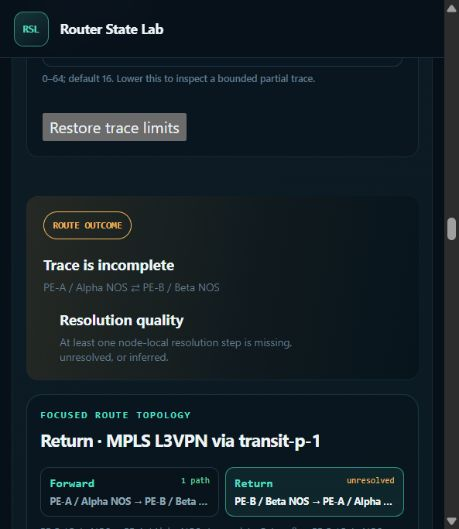
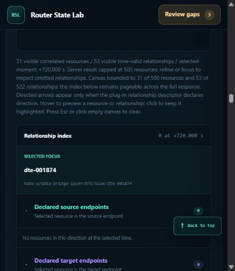
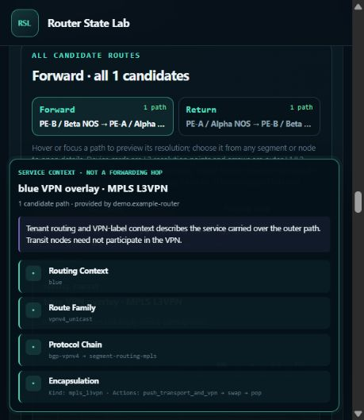

# Historical routes and resource correlations: second 100-move browser audit

Audited on 2026-10-23 against commit `141836e649510e21c56d469d9c93de3cc18f11ce`.
The pass found **three reproducible functional defects**. It also recorded
several-second cursor latency, without establishing a new CPU or memory regression.
This change records the audit; it does not repair the application.

Follow-up: all three functional findings are repaired and browser-validated in
the [repair report](../history-correlation-repairs-v2-2026-10-23/README.md), which
also attributes the remaining cursor cost and records the new 1M measurements.

## Scope and evidence

- Used the existing demo at `http://127.0.0.1:8883` in the in-app browser, including
  the compact viewport shown in the screenshots.
- Fixture: `demo/fixtures/router-state-lab-algorithms-2026-10-02.tgz`;
  SHA-256 `4cea20db78aa3fede9dc79a89a9277c5a9a72905fbff76a5f8436efd1c4aec30`.
  PE-A contains 1,250,005 normalized events and 7,510 resources.
- Performed **100 numbered UI moves** across direct and table-seeded traces,
  absolute/relative time, strict/best-effort topology clock policy, direction and
  graph-mode changes, fabric/node navigation, searched resource tables, exact
  lifecycle transitions, failed operations, log/lane navigation, and relationship
  pagination. A move is one stated UI action or short workflow, not an independent
  test case. Attempts, pending observations, and recoveries remain in the ledger;
  this is not a claim of 100 passing tests or exhaustive coverage.
- [Move ledger](moves.md), [machine-readable ledger](moves.json), and
  [evidence archive](evidence.zip) retain the outcomes. The archive contains all
  100 immediate DOM snapshots, settled supplements, screenshots, source oracles,
  and independent evidence reviews. [Manifest](evidence-manifest.json) records
  SHA-256 hashes for its members.
- Browser actions used the installed controls. Source review and small read-only
  generator calculations corroborated expected results; they did not replace
  browser validation. No injected DOM events or hidden application-state edits
  were used. No fixture, server, or product code was changed.

## HCR2-01 — P2: cross-node continuations carry the source device's clock

**Observed:** A blue MPLS L3VPN A→P1→B trace resolves forward at UTC +601.006 s,
although B's complete observation window is not available until +601.009 s.
At +601.010 s, forward resolves but B→P1→A remains incomplete at its final A
step. Both directions resolve at +601.015 s and +601.016 s. Going back to
+601.010 s reproduces the failure. Reversing the table-seeded source reverses
which displayed direction fails.

Reproduction:

1. Use the generated underlay, absolute UTC, and the blue VPNv4/MPLS L3VPN route
   between PE-A and PE-B with both directions enabled.
2. Apply `1759680601010000000` ns and run the trace.
3. Compare the resolved forward path with the unresolved return step at PE-A.
4. Apply `1759680601015000000` ns, rerun, then return to the earlier instant.
5. Repeat using the PE-A or PE-B MPLS L3VPN route-table row as the trace seed.

Evidence: moves 004, 008–010, 013, 022, 024, 026, and 029;
`move-002-settled.txt` supplies the early-admission control.
The topology clock policy was exercised in Strict and Best effort modes; the
route missing-hop policy remained Best effort. These are different controls.

**Root cause:** `demo/rsl_demo_generator/assembly.py:4041–4050` emits a continuation
owned by its executing node/revision but copies the source route's native
`observed_at_ns` unchanged. Core correctly validates that local decision in the
executing member's native-time interval and the referenced route in its source
owner's interval (`multi_node_route.py:1645–1653`).

The common authored observation is UTC +601 s. PE-A is UTC−4 ms with ±5 ms
uncertainty; P1 is UTC+1 ms with ±3 ms; PE-B is UTC+6 ms with ±9 ms. Their correct
admission times are +601.005, +601.003, and +601.009 s. Copying B's native
+601.006 timestamp into A incorrectly delays A's continuation until +601.015 s.
Copying A's timestamp into B creates the corresponding early-admission error.

**Repair direction:** convert the observation through UTC into the executing
node's native clock in the existing generator assignment, retain the independent
source-evidence validity gate, and regenerate affected sample archives. Do not
weaken core's uncertainty checks. The archived `finding-analysis.md` contains
the contract references, arithmetic, and precise source evidence.

## HCR2-02 — P2: broad correlation scope reports omitted focus as no relationships

**Observed:** At native +720 s, selected `dte-001874` has one outgoing relation
to `etg-001874`. “Show all correlations” retains that selected focus but reports
Relationship index **0** and “No resources in this direction at the selected
time.” “Focus selected” restores the relation immediately. The same result
repeats at the resource's exact creation time, native +120.187400000 s.

Reproduction:

1. In PE-A, choose the Decapsulation Tunnel Entry table and search `dte-001874`.
2. Select the row at +720 s and confirm its ETG1874 next hop.
3. Choose Show all correlations and inspect the selected-resource index.
4. Choose Focus selected. Repeat at exact creation after checking absence 1 ns
   before creation.

Evidence: settled full-view move 044 and focused controls 042/045; exact-creation
controls 087–091 provide another settled repetition. Immediate snapshots
040/041/043 were pending and are not used as settled defect evidence.

**Scope nuance:** the UI correctly discloses the 500-resource cap and its smaller
canvas. The bug is the categorical absence claim for a selected resource that
the response did not cover, not a missing general truncation warning or lost
backend data.

**Root cause:** broad mode sends no selected root (`app.js:7117–7127`), and the
scale query uses four representative roots (`revision_queries.py:722–725`).
`renderCorrelationList` retains the selected identity but counts only returned
edges and converts an empty result into a temporal absence claim
(`app.js:7521–7535`). It does not distinguish uncovered focus from known absence.

**Repair direction:** qualify the existing index counts and empty-state text
using returned coverage/roots, and retain the existing Focus selected recovery.
Keep query and canvas bounds. Expanding to a full unbounded graph is unnecessary.
See the archived `resource-finding-analysis.md`.

## HCR2-03 — P2: VPN tooltip intercepts the route graph-mode button

**Observed:** In the compact viewport, opening the blue VPN service context in
All paths places its tooltip over Focused path. Clicking Focused path leaves
All paths pressed. Enter on the same button switches successfully; after the
tooltip closes, pointer switching works in both directions.

Reproduction:

1. Run the blue VPN trace and choose All paths.
2. Open the “blue VPN overlay · MPLS L3VPN” service details.
3. Click Focused path. It remains unselected.
4. Focus that button and press Enter, then repeat pointer switching without the
   tooltip as a control.

Evidence: moves 031/032 were the first observation; 095/096 reproduced it after
a node/fabric round trip. At move 096 the Focused path button occupied
`x=229.6, y=260.475, width=184.2, height=25.5`; its center hit
`ASIDE#mn-route-hover-card`, whose rectangle was
`x=12, y=206, width=430, height=329.3`. Moves 097–099 demonstrate keyboard
recovery and successful unobstructed pointer controls.

**Root cause:** the existing service-preview positioner attempts side placement,
then horizontal and vertical clamping. With a 430-pixel card in this compact
viewport, clamping lifts a hit-testable card over the mode toolbar. Pointer
re-entry keeps it open. The mode handler itself works.

**Repair direction:** fix collision handling in the existing preview positioner,
using a vertical fallback and available-height bound when side placement cannot
fit. Preserve scrolling and pinned-card interaction; globally disabling card
pointer events would break those. This is a distinct compact-layout collision
from the previously repaired off-screen-anchor and resize/redraw defects.

## Performance observations and successful controls

Searched, fresh cursor workflows took roughly 4–7 seconds in the recorded
examples, including range entry, cursor selection, table/graph settlement, and
DOM capture. Rounded to tenths, moves 054/055 took 5.8/5.7 s, 059/060 took
7.2/6.3 s, 062 took 6.2 s, and 071 took 6.5 s. Nearby repeated timestamps
were faster: moves 052/053/056/072 each took about 1.9 s.

These are end-to-end audit timings, not isolated request latency or CPU time.
They include tool and observation overhead, and multiple independently settled
components. They are consistent with the already documented cost of uncached
point-in-time population/search reconstruction and its bounded cache. This pass
does **not** establish a new performance regression, memory leak, or backend
cancellation failure. No formal 1M CPU/memory benchmark was rerun in this audit.

Successful controls included:

- DTE1 absent 1 ns before creation, present at exact creation, absent again on
  reversal, and present on reentry.
- DTE1 retaining ETG1 at +360.037500 s and changing to ETG2 at +360.037600 s;
  DTE0 at the earlier instant correctly points to IP_ROUTING.
- ES restoration preceding DTE restoration; DTE0 and DTE1 restoring 100 μs
  apart with correct independent table and graph results.
- Failed DTE1 and DTE0 changes retaining the applied next hop; the successful
  DTE0 retry changing to ETG17; backward/forward repetition restoring each state.
- Applying a narrow range without changing the selected instant; failed-event
  log activation and reveal into the timeline; Ctrl-clicking a graph endpoint
  into its lane; Combined/Separate layout repetition.
- High-fanout relationship pagination retaining 60 entries across collapse and
  reopen, then advancing to 90. Bounded counts remained disclosed.
- Return to the fabric retaining the seeded route form, explicit rerun resolving
  both directions, and final direction switching after popup recovery.

## Limitations and evidence handling

- Some early snapshots captured pending work. The ledger marks them as such;
  later settled snapshots and explicit repetitions support the findings.
- Browser wait calls sometimes reported a 3-second transport/selector timeout
  even though the subsequent snapshot showed a completed trace. These are not
  application failures. Likewise a clipped log-row center could not be clicked;
  Enter activated the row and reveal succeeded.
- A graph-edge Enter attempt started off screen and left the card hidden.
  The following cursor change therefore does not validate a live pinned-card
  transition. No popup defect is inferred from hidden stale DOM text.
- After the graph-to-IP_ROUTING jump, that resource kind stayed selected. A
  DTE search correctly showed no IP-routing rows. Moves 082–086 therefore did not
  establish the intended DTE1874 lifecycle test; moves 087–091 corrected the kind
  selection and completed it. This retained explicit kind is not a bug.
- The route graph controls were unavailable before explicitly rerunning the
  restored form after returning from the node view. The failed move 093 is not
  classified as a product defect; move 094 completed the rerun.
- The final browser console check returned no captured warnings/errors. This
  does not establish absence of all server-side errors.

Documentation stewardship: reviewed the audit-only additions for plug-in author
impact. There is no change to public behavior, API, examples, or author commands;
no maintained author documentation or skill update is required. Frontend tests
were not rerun because application code and skills were unchanged.
