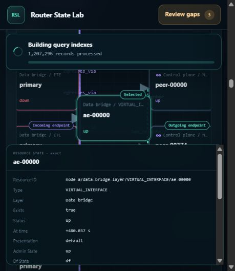

# Historical routes and resource correlations: third 100-move browser audit

Date: 2026-10-23. Build: `052903ee0bfb498357fa851b98d622ec9fc81d4c`, branch `codex/comprehensive-router-dump-demo`. **100 additional browser moves recorded; three confirmed functional defects.** This is an audit, not a repair. No product code, skill, fixture, or server configuration was changed.

The primary agent performed the browser operations. Supporting agents independently reviewed source-derived expectations, captured evidence, and process measurements. Their reviews are not additional browser runs.

## Confirmed findings

| ID | Severity | Defect | Reproducing moves |
| --- | --- | --- | --- |
| HC3-1 | P2 | Shared Ethernet Segment membership and active-path relationships appear before their attachment event. | 43, 46–47, 49–51, 53–54 |
| HC3-2 | P2 | Editing route family silently restores the old VPN family and VRF; configuration depends on edit order. | 37–38; initial symptom at 5 |
| HC3-3 | P2 | Narrow correlation graphs place a relationship label beneath a resource card, diverting pointer activation to that resource. | 77, 79, 89; keyboard controls 78, 88 |

### HC3-1: historical relationships precede the actual service attachment

In PE-A, select native offset **+240.010000000 s**, search `es-00000`, select its row, and inspect the focused correlation graph. It shows five relationships, including `etg-000375 → es-00000` (`member_of_es`) and `es-00000 → etg-000375/primary` (`active_path`). Service 375 does not attach until **+240.037500000 s**. At the earlier cursor, its resource-table state correctly says **single-home**, and its backup does not exist yet.

The table changes to all-active at the exact event and back to single-home when rewinding one nanosecond. The premature ES relationship remains. Full/focused graph switching reproduces it, as does service749/ES374 just before **+240.074900000 s**. These are two instances of one defect.

Root cause: `demo/rsl_demo_generator/_scale.py:1833` and `:1842–1848` start `member_of_es` and ES-to-primary `active_path` intervals at phase-wide `multi_start`. Actual attachment events are staggered by service index (`:1361–1366`) and add those relationships at the service's event (`:929–934`). Resource-lifecycle filtering masks the error for newly created ES endpoints, but not later services sharing an already-existing ES. Core interval filtering is honoring the interval it was given.

A repair should use the existing per-service attachment timestamp when writing these intervals, regenerate the fixture, and check both shared-ES examples before, at, and after the event. Hiding the edge in the frontend would leave the conflicting projection intact.

### HC3-2: routing-context controls silently discard the edited family

With MPLS L3VPN selected, enter `default` in VRF, then select **IPv4 unicast / ipv4/unicast** in Route family. Before changing Route type, the form has returned to **blue / VPNv4 / MPLS L3VPN**. Repeating the family selection has the same result. Changing Route type to IPv4 first, then entering default, accepts the intended context.

The initial A-to-CE-East attempt consequently requested blue IPv4 inventory and failed. The inventory error is valid for that request; the defect is the silent, order-dependent alteration of the user's requested context.

Root cause: `frontend/assets/topology.js:1377–1397` gives the existing route type priority in `resolveCompatibleRouteContext`, invoked by `applyCompatibleRouteContext` (`:1399–1403`). The VRF, family, and type change handlers all invoke the latter (`:10121–10141`). The resolver cannot distinguish which field the user intentionally changed. A repair should preserve the explicit edit and reconcile dependent controls, or explain the incompatible choice visibly. No new route-inference mechanism is needed.

Moves 20–21 did **not** reproduce the reset: fill plus Tab retained default. They remain inconclusive trigger attempts, not confirming evidence. Moves 37–38 use an actual select change and establish the behavior.

### HC3-3: resource cards cover clickable correlation labels

In the 474 × 546 CSS-pixel browser viewport, focus VIF0 (`ae-00000`) at **+480.037400000 s**. Activate the `has_neighbor` edge to `peer-00374`. Pointer attempts opened `peer-00000` or the selected `ae-00000` resource popup instead. Enter on the same edge opened the correct relationship and endpoints; opening the actual peer374 node also showed the correct resource.

The saved `edge-hit-test-after-click.json` places the label at x265.22–331.29, y259.30–270.49. At its center, `elementsFromPoint` returns the selected resource button **above** the SVG label. Thus this is real hit-target occlusion, not an edge-ID or keyboard-handler mismatch. This does not establish that every point on the edge is inaccessible at every width.

Root cause: the focused graph uses fixed 15/50/85-percent columns (`frontend/assets/app.js:7196`) and midpoint edge labels (`:7659–7686`). Narrow-screen cards remain 132/146 px wide (`frontend/assets/styles.css:4713–4718`). The outgoing label falls inside the selected card at sufficiently narrow widths. Resource cards stack above the SVG (`styles.css:1342–1409`). Pointer and keyboard handlers use the same edge identity (`app.js:7905–7926`). Repair the existing responsive layout's label space; merely moving the whole SVG above cards would risk reversing the interception.

## Performance observations

These are browser workflows plus one-Hz snapshots of the running Python server, **not** a new isolated 1M benchmark or browser-heap measurement. The archive has 1,250,005 normalized events and 7,510 resources on PE-A. Moves include form entry, native scrolling, snapshots, tool overhead, and sometimes several actions; their durations must not be presented as individual endpoint latency.

- Sampled server RSS began at **2.251 GiB**, peaked at **3.037 GiB**, and ended around **2.990 GiB**. Maximum sampled private memory was **3.032 GiB**. Shorter peaks may be missed; process-lifetime peak counters were not used as audit peaks.
- The largest CPU episode, **22:39:58–22:41:31 UTC**, used **93.219 CPU seconds over 93.005 wall seconds**, overlapping the first event-log search and subsequent cancellation/retry and resource operations. Resource selection stayed responsive during it.
- The UI showed **Building query indexes**. Read-only cache metadata confirms a newly completed v7 sidecar for the regenerated archive: 1,250,005 documents, 75,038,720 bytes, matching source identity. Its final file lifetime was approximately 51.3 seconds. This is comparable to the previously recorded cold construction cost (~46.7 seconds in `docs/root-cause-repairs-2026-10-22.md`), not evidence of a new regression by itself. Canceling the first search may have restarted partial work; request-level spans were not captured, so that attribution remains provisional.
- Warm exact-event search returned one matching record. Move 96 took 3.002 seconds; after clearing the filter, the same query in move 100 took **0.660 seconds**, including browser-tool overhead. The intervening unfiltered stream recovered all 1,250,005 events. There was no persistent search hang.
- Repeated searched cursor workflows remained visibly costly, often several seconds; move 73 took 9.457 seconds. Existing reports already identify fresh search projection and open point-in-time dashboards as costs. This audit does not isolate them enough to claim a new algorithmic regression or a leak.

See the attached process summary, final performance interpretation, raw samples, and per-move CPU join in `evidence.zip`. Moves 1–3 precede sampling. The sampler was stopped after the audit; the demo remains running.

## Correct behaviors and limits

- CE-East and Edge-C route admission changed at their exact UTC uncertainty boundaries; CE-East also changed back after rewinding. Transit-start forward paths began at P1; return paths targeted the packet source PE-A, without requiring P1.
- EVPN branches admitted at distinct +610.018/+610.019 UTC boundaries. One resolved branch alongside an unknown selected active branch correctly produced an incomplete aggregate under the existing contract; it is not an additional defect.
- ES374 withdrawal, staggered failover, mixed primary/backup states, restoration, and backward time travel matched the fixture's event history. VIF0 neighbor creation, withdrawal, and restoration matched exact boundaries; structural associations remained while neighbors were down.
- Full/focused correlation switching, disjoint resource searches, graph collapse/reopen, and node/fabric navigation were exercised. Browser Back returned the explicit original node URL's absolute time, not an independently moved cursor that had never been written into that URL. Pending navigation snapshots are not treated as settled results.
- Four automation attempts were inconclusive: move 5 waited for a success-only result despite a visible error; 11 and 17 had browser click-location failures; 18 never established submission. These are not four product defects or performance stalls. Moves 20–21 failed to trigger the context-reset reproduction. The ledger preserves all six without counting them as passes.
- The event inspector in move 97 confirmed the exact ES374 withdrawal event but did not expose `affected_services`. A separate source-only candidate remains: generator withdrawal/restore events hard-code 3 affected services, whereas this canonical fixture has 2 per ES. It is **not counted among the three browser-confirmed defects**.
- This is 100 recorded operations/workflows, including retries and preparation, not 100 independent assertions or 100 passing tests. No frontend test suite or full 1M memory/CPU benchmark was rerun for this audit-only request.

## Evidence and stewardship

- `moves.md` / `moves.json`: numbered actions, expectations, observations/classifications, timestamps, and measured workflow duration.
- `evidence.zip`: all 100 DOM snapshots, source-derived oracles, independent reviews, process samples/summaries, hit tests, screenshots, and sampling scripts.
- `evidence-manifest.json`: ZIP and individual-entry SHA-256 hashes; archive verified after packaging.
- The live demo was PID 12380 on port 8883. Fixture SHA-256: `fb1ef97c01ef7306d0e4104cedcaba2fd3615bb701c5d9cc3aa6abc92f273470` (`router-state-lab-history-clock-2026-10-23.tgz`). No server restart or fixture regeneration was performed.

The plug-in-documentation drift check is complete: this change records audit evidence only. It changes no public plug-in behavior, author-facing command, contract, runnable example, or skill, so maintained authoring documentation required no update. The API validation inventory command was used for orientation; it is not claimed as a conformance test run. The pre-existing generated-archive lock file was left untouched.
