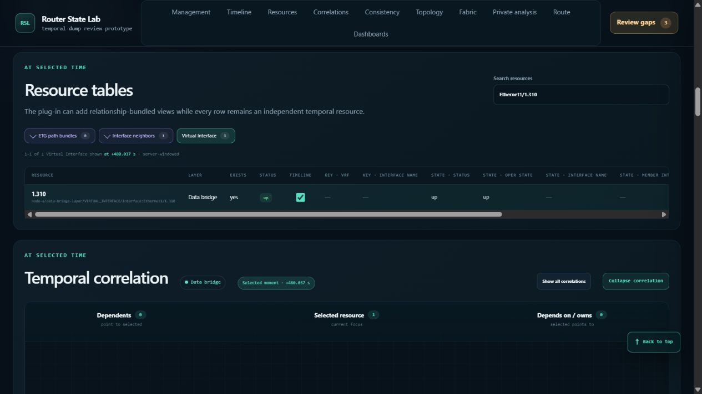

# Historical routes and resource correlations: fourth 100-move browser audit

Date: 2026-10-23 (browser captures continue into October 24 UTC). Build: `4f49279e9192709aa81b5fa305b69051708d4e51`, branch `codex/comprehensive-router-dump-demo`.

**100 additional browser operations/workflows recorded: 83 passed their scoped checks, 11 exposed a defect, and 6 were inconclusive attempts. The 11 defect observations represent three distinct findings.** This is an audit, not a repair. No product code, skill, fixture, or server configuration was changed.

The primary agent performed all browser operations through the in-app browser. Supporting agents reviewed source-derived expectations, evidence, and performance measurements; their reviews are not additional browser runs. Each numbered move can contain several related UI actions, and retries/preparation are included. This is not a claim of 100 independent assertions or 100 passing tests.

## Confirmed findings

| ID | Severity | Defect | Reproducing moves |
| --- | --- | --- | --- |
| H4-1 | P2 | Node controls are enabled before their handlers exist. Early Apply range performs a native GET that removes node/time/return context; early Collapse is ignored. | 36, 43, 45, 47 |
| H4-2 | P2 | Slash-containing interface names become suffixes such as `1` or `1.310` in resource tables, correlations, and route-table egress labels. | 37–38, 86–87, 98 |
| H4-3 | P2 | Resizing a correlation graph removes valid keyboard focus and dismisses its pinned popup. | 59, 61 |

### H4-1: early range submission discards contextual navigation

Open a cold node workspace from a historical fabric capture. While the page still says **Loading analysis workspace**, enter a start/end range and press **Apply range**. In move45, the full PE-A contextual URL, containing `topology_id`, `node_id`, `time_ns`, and `return_to`, became:

```text
http://127.0.0.1:8883/node?#temporal-topology
```

The entered range and search text reset, and the UI reported two active loading operations. Browser Back restored the contextual URL. Repeating the early submission with a different range in move47 reproduced the same empty query. After startup completed, Apply range worked normally. Early **Collapse correlation** clicks on P2 and PE-A were also ignored, whereas a settled collapse/expand cycle worked.

Root cause: `frontend/pages/node.html:264` declares an enabled form with no action or method. Its range inputs and submit button have no names, so native GET submission has no fields. `frontend/assets/app.js:12747–12800` awaits bootstrap and timeline loading before calling `bindControls()`. The submit listener at `:12506` is therefore absent during loading; `applyRangeEditor()` cannot prevent the native submission. Correlation-button binding has the same late initialization boundary.

A repair should address the existing control initialization/readiness lifecycle, including preventing native submission before the asynchronous bootstrap. Merely recovering the lost URL afterward would leave the cause intact.

The two-operation message does not establish a server leak, failed cancellation, or the duration of duplicate work. Early search input alone survived normal successful initialization and was applied on P2; its loss here followed a full page navigation.

### H4-2: interface labels discard meaningful slash-delimited names

Search P2 for `Ethernet4/1` and open its Virtual Interface row. The resource table and focused graph label it **1**. On PE-A, searching `Ethernet1/1.310` yields **1.310** in both views. In the fabric route table, Edge-C's egress `Ethernet1/1` also appears as **1**.

The full canonical IDs remain available and searches find the intended resource. The observed historical status is correct; this is a naming/disambiguation defect, not canonical-ID corruption or a wrong correlation endpoint.

There are two affected producer paths with the same unsafe assumption:

- `demo/rsl_demo_plugin/scale.py:90–98` derives a display label from the last slash-separated component. `scale_resource_record()` at `:195` supplies it to normalized resource records, including the source rows loaded through `scale_data.py:1050–1083`. The single-node frontend honors that supplied label (`frontend/assets/app.js:2211`).
- `src/router_dump_analyzer/multi_node_route.py:4379` independently uses `egress_resource_id.rsplit('/', 1)[-1]` for the generated route-table egress name. `frontend/assets/topology.js:9607` displays that server-provided name.

Fixing only the scale helper would leave route-table labels broken. Prefer producer-declared display information and preserve the opaque handle when no label exists; the generic frontend should not parse demo interface IDs. Slash characters inside the declared interface name are meaningful. The topology generator already has an example of preserving the name while removing only the `interface:` prefix (`demo/rsl_demo_generator/assembly.py:2657–2664`).



### H4-3: resize discards a still-valid graph interaction

In a 474×546 viewport, focus ES1 and press Enter on its `uses_interface` edge to `ae-00001`. The SVG label owns keyboard focus and its popup is visible. Resize to 1280×720 without changing time, resource, or graph mode: focus becomes BODY and the popup is hidden. Reacquire the same edge in the narrow viewport and change only height from 546 to 700: the same loss occurs.

`resize-focus-check.json` records the before/after focus, popup, and scroll state; `height-resize-focus.json` records the second reproduction. The temporary viewport override was reset afterward.

Root cause: the resize handler in `frontend/assets/app.js:12561–12573` schedules an unconditional `renderGraph()`. That renderer closes the popup (`:7786`) and replaces the graph subtree (`:7832` onward), deleting the focused SVG element. The existing retained-inspection path restores highlight classes and pressed state, but neither keyboard focus nor the popup's replacement anchor. A repair should preserve the valid interaction through the existing redraw lifecycle.

The horizontal scroll value reaching zero when the viewport widened is not counted as another defect; the wider viewport can legitimately remove overflow. This finding concerns focus and a pinned popup whose relationship remains valid.

## Performance observations

The process measurements and interpretation are in [performance-summary.md](performance-summary.md). They cover the already-running Python demo throughout this browser audit, not browser heap or a new isolated 1M benchmark. They include cold node switching, resource search, live dashboards, repeated historical cursors, and fabric/route operations.

- 1,473 samples covered approximately 1,472 seconds, with one process identity and a clean sampler stop. Sampled RSS began at **2.885 GiB**, peaked at **2.972 GiB**, and ended at **2.958 GiB**. The peak is from this audit's samples, not the process-lifetime high-water counter.
- Total server CPU increased by **486.766 seconds**. Broad cold-entry phases, including initial search or reload attempts, used approximately 74.31 CPU seconds for P2 and 113.14 CPU seconds for PE-A. These are workload brackets, not isolated node-load timings.
- The P2-to-fabric interval used approximately 4.16 CPU seconds across a 22.423-second observation window. It does not support a full default-node history reload on every fabric return. The later warm fabric return was observed ready within 9.530 seconds; the time between observations is not exact server latency.
- Historical resource operations continued to consume substantial CPU: one episode spanning VIF focus and neighbor-boundary checks used **36.234 CPU seconds over 42.004 wall seconds**. The measurements establish recurring work, but do not isolate a new algorithmic regression, persistent search stall, or memory leak. Existing searched-cursor and live-dashboard costs remain relevant.

Workflow durations include form entry, native scrolling, snapshots, browser-tool overhead, and sometimes several actions. Delayed follow-up observations are not precise response completion timestamps. Neither a tool timeout nor a single high-memory sample establishes a product stall or leak.

The source review also identified a first-use optimization candidate: `DemoTopologyProvider.get()` loads the default node's full dataset to obtain four scalar topology metadata fields. The topology provider is cached for the runtime session, so this does **not** establish that every warm return to fabric reloads history. Explicitly opening PE-A after P2 can cold-load because the node history cache retains one materialized revision. `/health` can itself load the default node and was not used as an observer in this audit. See the source review in the evidence archive.

## Correct behavior and limits

- A/B default IPv4 route admission changed at UTC +601.009s, D/E red VPN at +601.008s, and CE-West/Edge-C at +601.025s. One-nanosecond rewinds produced incomplete evidence, and exact-boundary retries resolved. Clock uncertainty remained explicit.
- Explicit family edits reconciled VRF/type correctly, including VPNv4 to default IPv4. Historical route-table rows seeded the expected endpoints and preserved the capture context. Forward/return and all/focused views retained the selected direction. Return-only tracing reported the other direction as not requested.
- ES1 attachment at native +240.0376s, ES0 staggered failover at +360.0375/+360.075s, and restoration at +480.0375/+480.075s matched tables and graph edges. Rewinding one nanosecond restored the preceding state. The previously repaired premature shared-ES attachment did not recur in these checks.
- DTE0 used its even-service IP fallback; DTE1 used its odd-service ETG2 fallback. VIF0's second neighbor appeared exactly at +120.0374s; withdrawal/restoration status changed at its own times, while declared structural associations remained present when neighbors were down.
- Returning from the independently moved local cursor restored the fabric URL's original absolute UTC +96.010s context. Early P2 interface search survived successful initialization, and its stale down notification did not overwrite the authoritative up snapshot.
- A tested full-graph relationship label was directly hittable; the suspected pointer occlusion was not reproduced. Prior narrow-layout repairs must not be declared broken based on the distinct resize-focus defect.
- Six attempts remain inconclusive: 18 used the wrong accessible action name; 19 submitted after that failed seed and therefore did not test the intended new route; 25 tried to seed while tables were refreshing; 68 clicked before a changed search result arrived; 78 used an ambiguous cell locator matching two views; 96 hit a browser-control timeout even though the subsequent UI showed its return-only selection had applied. Later valid operations exercised the corresponding workflows. These are not six product defects.
- No warning/error entries were returned by the final browser console query. This is a bounded query, not proof that every browser event was captured.
- No frontend test suite or full 1M memory/CPU benchmark was rerun for this audit-only request. No product repair is claimed.

## Evidence and documentation stewardship

- [moves.md](moves.md) / [moves.json](moves.json): all 100 numbered workflows, expectations, observations, classifications, timestamps, and action durations.
- [evidence.zip](evidence.zip): initial and settled DOM captures, source oracles/reviews, process samples and analysis, focus/hit checks, screenshots, and sampling scripts.
- [evidence-manifest.json](evidence-manifest.json): SHA-256 hashes for the ZIP and each entry, verified after packaging.

The live demo was verified as PID 35624 on port 8883, serving `router-state-lab-history-correlation-2026-10-23.tgz`, SHA-256 `5f204e5836be8966f148ae14671f9488007970619cff094cc9bda60c71892105`. PE-A contains 1,250,005 normalized events and 7,510 resources; P2 contains 1,250,006 events and 7,506 resources. The sampler was stopped cleanly; the demo and its final historical route view remain open.

The plug-in-documentation drift check is complete. This change records audit evidence only and changes no public plug-in behavior, author-facing command, contract, example, or skill, so maintained authoring materials required no update. The validation skill's inventory command was used for orientation and passed in the installed demo environment; this is not claimed as a conformance test run. The pre-existing generated-archive lock file was left untouched.
