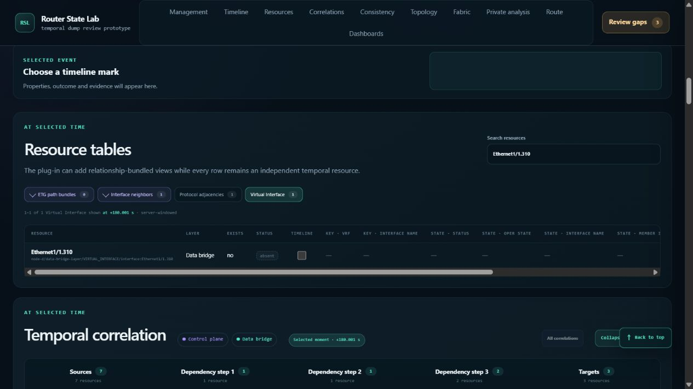

# Historical route and resource correlation browser audit — round 5

Resolution: all three defects were repaired and browser-validated on October 24.
See the [repair and measurement report](../history-correlation-v5-repairs-2026-10-24/README.md).
The observations below describe the original audited version.

Completed **100 additional browser workflows** on `d29f98102f8d2a355d93209cd192c59de5916d35`, using the running local demo and the existing history/correlation fixture. The run crossed midnight on October 23–24, 2026 (America/Toronto).

**93 scoped passes, five defect observations covering three functional defects, and two inconclusive attempts.** These are workflow outcomes, not 100 independent assertions or exhaustive feature coverage. Repetitions and follow-up controls belong to their numbered workflow. The final popup workflow includes additional native-keyboard reproduction after the process sampler stopped.

The audit also confirmed substantial recurring cursor CPU work. It did not identify a new permanent stall or establish a memory leak. Product code, fixtures, skills, and tests were not changed or rerun for this exploration.

## H5-1 — Absolute fabric-to-node navigation uses UTC as native time (P1)

**Moves 32–43; defect observations 35–36.** Fabric reconstruction at UTC `1759680179993000000` (base +179.993 seconds) shows PE-D's `Ethernet1/1.310` attachment as **Usable / Best Effort**. Opening PE-D from that applied view instead selects native **+180.001 seconds**, and the resource table reports **Exists no / absent**.

PE-D's native clock is UTC minus 8 ms. The correct native cursor is `1759680179985000000`, offset +179.993 seconds. Its interface deletion is at native `1759680179992000000`, offset +180 seconds. The fabric uncertainty interval, +179.987 through +179.999 seconds, is entirely before deletion: uncertainty cannot explain the disagreement.

Local controls independently prove that the resource reconstruction is correct: native `179.999999999 → 180 → 180.000000001 → 179.999999999` gives **present → absent → absent → present**. Keeping the deleted resource selected also correctly reports that it is outside its lifecycle, then restores it on rewind.

Root cause: fabric already computes `local_time_ns`, but deep links retain the original UTC selector. `basisForNode` prefers `query_time_ns`; node workspace loading echoes the request; `app.js` initializes the native cursor directly from `navigationContext.timeNs`. The banner incorrectly calls this raw value resolved. Timeline and resource requests use the wrong cursor, so this is not a display-only discrepancy. See [source-chain review](navigation-root-cause.md).

Reproduction: reconstruct the above UTC instant with all fixture members, inspect PE-D's Ethernet1/1 connector, open PE-D, search `Ethernet1/1.310`, and select Virtual Interface. Compare the cursor and existence with the originating fabric state.

## H5-2 — Relative fabric-to-node navigation ignores the offset (P1)

**Moves 67–72; defect observations 69 and 72.** Reconstructing fabric at **watermark −120 seconds**, then opening PE-D, selects native **+720 seconds**, the latest capture. Repeating at **−360 seconds** again opens +720. The banner claims “opened at its resolved time” for both −2m and −6m contexts.

The fabric view and return link preserve the requested offsets. Node initialization has no `time_ns` for a relative request and falls back to capture; `basisOffsetNs` is parsed and displayed but never applied to the cursor. This shares H5-1's missing resolved-native-time handoff. A repair must use the selected member/projection's resolved watermark, which need not equal dump capture; subtracting the offset from an assumed capture is not a general solution.

Saved node DOM states 069 and 072 contain both the relative-context banner and +720 selected-moment readout. The screenshot for 069 shows the resulting native capture timestamp in the followed topology controls; it does not contain the banner and is not the sole evidence.

## H5-3 — VPN popup activation is lost during smooth focus scrolling (P2)

**Move 100, with repeated controls on an unchanged, settled route.** Activating an off-screen VPN service strip can focus and scroll it into view while leaving its popup hidden and empty. A second Enter after scrolling settles opens it. Already-visible activation and an ordinary Tab sequence through nearby visible controls passed.

Native reproduction on the settled B→A blue MPLS L3VPN trace:

1. Dismiss the popup and click **Focused path**.
2. Scroll the page up about 0.6 viewport heights while retaining focus on that button, leaving it and the subsequent service strip below the viewport.
3. Press **Tab**, then immediately **Enter**, while the browser is revealing the service strip.
4. The strip initially has top approximately 837 px in a 720 px viewport. After smooth scrolling completes, its top is approximately 341 px and it is fully visible, but the popup remains hidden and empty.
5. Press Enter again: the correct service card opens.

This also reproduced when the browser locator focused the off-screen strip and sent Enter. The native sequence above rules out a locator-only artifact. The initial automated pass classification was withdrawn after saved-evidence review; initial failure, repetition, and recovery evidence are retained.

Root cause: the service-strip focus/Enter handler runs the popup visibility check before smooth focus scrolling finishes. That check clears both popup and trigger. Later scroll handling has no retained trigger to reposition or reopen. Existing clipping dismissal and delayed-render protections do not cover this activation ordering. See [popup source review](vpn-focus-scroll-root-cause.md).

## Performance observations

The existing demo process was sampled once per second without extra API requests. Sampling covered `2026-10-24T03:38:04.502Z–04:00:21.490Z`; late native-keyboard verification of move 100 is outside that coverage. The server remained running after the sampler stopped.

| Metric | Observation |
| --- | ---: |
| Process CPU across sampled period | 363.703 seconds |
| RSS at start → end | 2.837 → 2.938 GiB |
| Maximum sampled RSS | 3.258 GiB |
| Maximum sampled private commit | 3.251 GiB |
| Cursor + search, move 44 | 8.016 CPU seconds in enclosing bracket |
| Failed-event jump, move 57 | 7.922 CPU seconds in enclosing bracket |
| ES withdrawal cursor, move 51 | 9.484 CPU seconds in enclosing bracket |

The cold PE-D entry accounts for the sampled memory peak and about 78 CPU seconds in its broad observation bracket. Warm reopen brackets used about 9.3–9.6 CPU seconds. These include initial component queries and are not isolated loader or reopen-validation timings.

Cursor changes launch graph, resource, dashboard, and followed-topology work. Fresh resource searches build text across the inventory; dashboards independently reconstruct their populations. Those are source-supported contributors, not per-request attribution from this run. Graph-only scope/focus controls were much cheaper. The process was mostly idle well before several saved follow-up observations, so the 21–25 second action-to-observation gaps must not be described as measured server latency.

This is a mixed live-browser workload, not a new isolated 1M benchmark or a before/after comparison. It confirms the recurring cost without proving a new algorithmic regression, permanent stall, or leak. Browser/GPU memory was not sampled. See [measurement details and limits](performance-summary.md) and `performance-stats.json` in the evidence archive.

## Checks that passed and inconclusive attempts

- A/B VPN admission: at UTC +601.006 and +601.008999999, source evidence can exist while the complete trace remains incomplete; at +601.009 and +601.010, forward and return resolve. Direct and route-table-seeded flows, reversed endpoints, strict/best-effort clock policies, focused/all paths, and repeated rewinds agreed.
- Shared ES1 membership attaches at its exact event boundary. Withdrawal closes `uses_interface`; persistent membership remains while independently timed `active_path` edges switch primary→backup. Restore returns the interface before service primary paths recover.
- DTE9's failed +600.0759 update retains applied IP_ROUTING, rather than the attempted ETG10 next hop. Before/exact/after successful changes and backward traversal agree with the generator oracle.
- Followed single-node topology reports old dependency, ambiguity within its ±5 ms uncertainty window, then the new dependency. The synthetic local-clock readout is not evidence of an additional state lag.
- Move 33's first connector activation produced no inspector; a later keyboard activation succeeded. The first attempt remains inconclusive rather than a confirmed defect.
- Move 73 tried to compare a resource omitted from the bounded 80/7,505 topology page. Omission does not establish incorrect state; covered DTE9 controls passed in moves 74–77.

## Reproducibility and scope

- [All 100 workflows](moves.md) contains outcome, observation, expected result, timestamps, and supplemental actions. `moves.json` and initial/settled DOM snapshots are in the archive.
- [Evidence archive](evidence.zip) contains browser snapshots, screenshots, console records, fixture oracles, source reviews, process samples, identity checks, and analysis scripts. [SHA-256 manifest](evidence-sha256.json) records every archive entry and the archive hash.
- Fixture: `demo/fixtures/router-state-lab-history-correlation-2026-10-23.tgz`, 286,504,605 bytes, SHA-256 `5f204e5836be8966f148ae14671f9488007970619cff094cc9bda60c71892105`. PE-D contains 1,250,004 matched events and 7,505 resources.
- Browser console warning/error query was empty at the end of the main 100-move sequence. This is not a network-request or server-error audit.
- The plug-in validation skill and source oracles guided the audit. A separate read-only evidence review checked saved outcomes and caught the initially unsupported move-100 popup pass.
- Conformance inventory listing passed. No full conformance, frontend test suite, or new 1M benchmark was run for this audit-only request.
- **Plug-in-documentation drift check completed:** only audit artifacts were added; no discovery, contract, capability, author command, runnable example, or public plug-in behavior changed. No maintained authoring-document or skill update was required.

No fixes, commit, or push are included in this audit.
