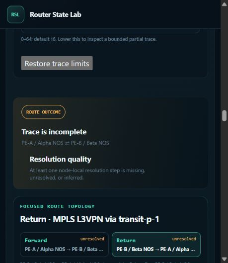

# Historical route, correlation, and cursor repairs

This follow-up repairs HC-01, HC-02, and HC-03 from the
[100-move browser audit](../history-correlation-100-browser-audit-2026-10-23/README.md).
The pre-existing VPN popup repairs were preserved. Implementation and validation
were completed before publication.

## Root causes and changes

| Finding | Root cause | Repair |
| --- | --- | --- |
| HC-01: past routes used future observations | Route tables exposed validity without applying it; direct traces could bypass the table | Apply the same half-open validity check to table rows, forwarding decisions, referenced route evidence, and route correlations. Map the entire resolved uncertainty interval into each evidence owner's native clock. Unavailable evidence remains unresolved, including best-effort traces. |
| HC-02: typed P1–P2 link ignored carrier history | The demo state provider discarded the selected time and reused initial claims | Reuse the existing temporal evaluator for the interface's history. Preserve failed-operation semantics, existence, and ambiguous clock quality before typed projection derives usability. |
| HC-03: pinned correlation popup blocked distant controls | Its position was calculated only when opened, without tracking the anchor's clipping | Reuse the existing position calculation on captured scrolling and resizing. Close a card when its anchor leaves the viewport, sticky-header boundary, graph, table, or relationship-list scrollport; retain partially visible anchors and internal card scrolling. |

The route repair carries validity through existing normalization instead of
adding another global route-row scan. The popup repair retains the semantic graph
pin while dismissing its off-screen card; scrolling back does not revive the card.
Horizontal and vertical SVG strokes remain valid anchors despite a zero-height
or zero-width geometry box.

Snapshot observations are not earlier historical evidence. The fixture's route
rows observed around +600 s cannot establish reachability at +100 or +241 s,
even when a carrier has recovered. The carrier integration test gives copied
route projections earlier explicit validity to isolate carrier behavior; the
browser uses the original unmodified fixture.

## Slow cursor updates

Searching at a new cursor reconstructed all 7,510 resources, published their
complete client state, then projected that state again for search. It also
repeated dataset loading and descriptor lookup per resource. The existing
reconstruction is now shared by a private helper: ordinary resource reads retain
the full safe projection, while search uses its existing safe searchable-field
projection directly. Compiled property-trie traversal also avoids redundant
generic mapping checks. No cache, index, public API, or retention bound was added.

Quiet paired measurements use the same 1M fixture, loaded dataset, warmed
histories, cleared search snapshots, and alternating before/after order:

| Eight uncached searched cursors per implementation | Before | After |
| --- | ---: | ---: |
| Median elapsed | 2.7967 s | 1.5514 s |
| Median process CPU | 2.7500 s | 1.5391 s |
| Empty-search median elapsed | 38.94 ms | 36.36 ms |

Searched-cursor CPU fell **44.0%** and elapsed time **44.5%**. All 16 complete
searched/empty paired responses matched; 40 preliminary full-scale response
digests also matched. Instrumented attribution reduced full/search projections
from 15,021 to 7,511 and dataset loads from 7,512 to 2. These profile timings are
not browser latency measurements.

The remaining cost includes resource-state reconstruction and searchable-field
projection across all resources at a new timestamp, needed for cross-kind counts.
Initial lazy history construction also remains. Per-query RSS stayed flat after
allocator warmup; the separate navigation benchmark measures process peaks.

## Validation

- Frontend contract check and **626 tests passed**, with no skips.
- **40 cursor/backend tests passed**, including 144 disclosure, time-boundary,
  Unicode, layer, paging, and cross-kind-count subcases.
- The exact documented command, `python -m unittest
  tests.test_route_history_validity tests.test_generated_assembly_api_integration
  -v`, passed **19/19 tests in 327.259 s**. This includes the initial eight focused
  historical route/provider/integration/control checks, covering
  direct and table-seeded bidirectional traces, past → present → past repeats,
  carrier changes, lifecycle, failed changes, and clock uncertainty, plus every
  registered route and packet scenario.
- **23/24 boundary checks passed**. The remaining mapping-guard test reports
  two unchanged HEAD findings: `timeline-condition` in `revision_queries.py` and
  `http.disconnect` in `_query_cancellation.py`. An isolated HEAD reproduction
  confirms both predate this repair; no guard exemptions were added.
- **149 module stubs verified**; selected-file Ruff passed.
- Skill validation and conformance command inventory passed. All **18 distinct
  author-document tests passed** across the initial run and focused smoke retry,
  including the documented quickstart commands. The first smoke attempt exceeded
  the Windows durable-state path limit because of the audit's long temporary
  directory; the same test passed with a shorter isolated temporary path.

Sandbox HTTP tests initially stalled in Windows Proactor loopback socket setup.
Captured stacks identify that setup limitation; the same focused tests passed
with host execution permission. These interrupted attempts are preserved rather
than counted as product assertion failures.

The plug-in documentation drift check updated temporal evidence guidance in the
quickstart, guide, contracts, validation guide, demo README, and root links. The
example provider now exercises historical reconstruction; the minimal parser
example needs no new API. The validation skill now requires exact-time route
checks, real traversed-link coverage, settled table/graph comparisons, and popup
clipping checks.

## Browser verification

The parent operated the existing browser against the 1M demo on port 8883.
The final route checks used a fresh server with the finalized provider code.

- At UTC +100 s (`1759680100000000000` ns), all future route rows are absent
  (`0 / 0`). A direct blue / VPNv4 / MPLS L3VPN PE-A ⇄ PE-B trace reports
  **Trace is incomplete**, both directions unresolved, with core explanations
  that route or forwarding evidence is unavailable at the selected time.
- At +700 s, the table has 693 routes and the same VPN trace reports both
  endpoints reachable. Returning to +100 s restores zero rows and an unresolved
  trace; no later result leaks backward.
- The actual typed P1 Ethernet3/1 → P2 Ethernet4/1 circuit, `10.64.255.0/31`,
  reports **unusable → usable → unusable** at +100 → +241 → +100 s.
- In PE-A's single-node workspace, an Enter-pinned DTE card closes when scrolling
  to and opening timeline Actions, without Escape. Space activation and the
  repeated cross-component move behave the same way. Dismissing the card retains
  the graph's semantic pin; toggling it and reopening still works.
- With `IP_ROUTING` search retained, +360.0375 → +359 → +360.0375 s produces
  matching table and graph state: DTE-000000's next hop switches from IP_ROUTING
  to ETG-000000 and back. The search count changes from one DTE to zero and back.
  Assertions waited for both table and graph update notices to clear.

The browser's narrow 459-pixel viewport made the tiny SVG edge's pointer target
overlap its node. That attempt is not claimed as a manual edge-popup pass;
zero-height/width stroke anchors and nested relationship-list clipping are covered
by focused production-function regressions. One initial pointer command timed
out after hovering; the subsequent observed keyboard activation passed. A server
started before final import cleanup rejected its changed executable identity;
restarting after edits finished restored loading. These setup/tool observations
are preserved in the ledger.

## Full-scale memory and CPU measurement

The unchanged 52-phase Windows harness loaded PE-A, exercised search, paging,
density and location, retired it, loaded another full node, and returned to PE-A.
The fixture is `router-state-lab-algorithms-2026-10-02.tgz` (286,496,584 bytes;
SHA-256 `4cea20db78aa3fede9dc79a89a9277c5a9a72905fbff76a5f8436efd1c4aec30`).
PE-A has 1,250,005 events and 7,510 resources. Python was 3.12.13 with
`PYTHONHASHSEED=0`, a fresh process/search cache, and 100 ms memory sampling.
Tests had exited and browser activity was idle throughout measurement.

| Metric | Previous quiet run | This quiet run |
| --- | ---: | ---: |
| Loaded RSS | 2.17565 GiB | 2.17854 GiB |
| Lifetime peak RSS | 2.25441 GiB | 2.25558 GiB |
| Lifetime peak private commit | 2.24959 GiB | 2.25077 GiB |
| Sum of 52 phase CPU occurrences | 168.26563 s | 155.71875 s |
| Harness elapsed | 172.984 s | 161.625 s |
| Search sidecar | 75,038,720 bytes | 75,038,720 bytes |

Memory is effectively flat: loaded RSS increased about 2.96 MiB and peak RSS
about 1.20 MiB. CPU was 7.46% lower and elapsed time 6.57% lower than the
[previous quiet VPN-repair run](../vpn-popup-repairs-2026-10-23/README.md).
This is a historical single-run comparison, not an isolated causal speedup:
OS caches were not flushed and the harness excludes browser memory. Use the
alternating paired cursor measurements above for attribution of that change.

Both runs completed with exit 0 and no safety stop. All **52 ordered phase
results**, **35 complete page hashes**, cache-retirement, shared search-cache,
validation-cache, and initial/returned search invariants match. Every repeated
phase occurrence is retained in [comparison.json](comparison.json), not collapsed
by phase name. Sidecar storage is unchanged.

## Evidence

- [Browser check ledger](browser-checks.json): observations and setup limitations.
- [Cursor comparison](cursor-comparison.json): paired timing and output equality.
- [Source hashes and revision](source-metadata.json): final implementation identity.
- [Evidence archive](evidence.zip) and [SHA-256 manifest](evidence-sha256.json):
  browser snapshots/screenshots, test logs (including failed setup attempts),
  profiler scripts/results, exact baseline module, unchanged 1M harness,
  baseline/final results, all memory samples, and ordered comparisons.

The archive was reopened and every entry verified against its SHA-256 digest.
