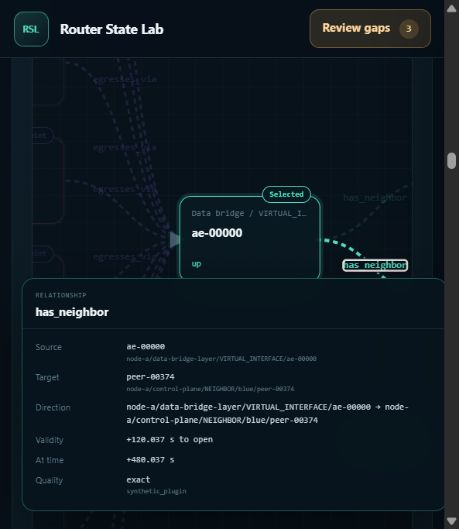

# Historical route and correlation repairs — 2026-10-23

Repairs for all three findings in the [third 100-move audit](../history-correlation-100-browser-audit-v3-2026-10-23/README.md), against base commit `052903ee0bfb498357fa851b98d622ec9fc81d4c`.

## Root causes and repairs

| Finding | Root cause | Change |
| --- | --- | --- |
| HC3-1: premature shared-ES relationships | Persisted intervals used the phase start, although each service attaches at its own staggered event. Existing shared endpoints defeated lifecycle filtering. | Use the existing per-service attachment timestamp for all five affected relationship observations. Regenerate the ten-node archive. Core temporal filtering is unchanged. |
| HC3-2: route family/VRF edits silently reset | Compatibility resolution always favored the old route type, without knowing which control the user edited. | Pass the edited field into the existing resolver; preserve the advertised explicit choice and reconcile dependent controls. Scenario/seed defaults retain their existing precedence. |
| HC3-3: narrow graph labels open a resource popup | Fixed percentage columns left insufficient space between cards; a card covered the relationship label and intercepted its pointer hit. | Measure existing cards and SVG labels, reserve a minimum focused-canvas width, and let the graph scroll horizontally. Preserve identity handlers and stacking. Full mode keeps its existing width. |

The adjacent source-only finding was also corrected: ES withdrawal/restoration events now derive `affected_services` from actual strided membership rather than hard-coding three. The canonical layout has two services per ES; an uneven small-layout regression checks counts of three, two, and two. This is an O(1) count, not a new index or cache.

No public API, plug-in hook, core inference rule, graph limit, or cache bound was added.

## Validation

- `npm --prefix frontend run check`: **639 passed, 0 failed**. The first sandbox run hit loopback `EACCES` in the proxy suite (ten children and their parent); the approved host rerun passed everything. Both logs are retained.
- `python -B -m unittest tests.test_scale_generator_optimization tests.test_route_history_validity -v`: **8 passed** in the final consolidated run. Workspace-local `TEMP`/`TMP` avoids the initial sandbox temporary-directory permission failure.
- New regressions cover attachment-event/interval agreement across small and canonical layouts, actual affected-service counts, installed route-control handlers and submitted context across edit orders, and graph rendering/geometry and activation handlers.
- Both updated skills pass `quick_validate.py`. The conformance inventory command passes; it is an inventory check, not a full conformance-suite claim.
- GPT 6.1 Sol agents used the authoring skill for the frontend changes. A fresh GPT 6.1 Sol validation agent used the updated validation skill, current source/tests, and contract references, excluding audit reports, parent logs, and other agents' outputs. Its independent executable check passed **312 temporal assertions** across three layouts, including before/exact/after/backward checks. Its focused tests passed. It did not use the browser; the parent performed the live checks below.
- The independent generator review found no blocking issue. The independent benchmark review verified raw ordered results rather than relying only on the comparator summary.

The updated validation skill's SHA-256 is `ede01d16c79878785504ba4ca2f9e4829e85e600ae5a5015fb8a67cb02606484`. The trial prompt, report, executable checks, parent validation logs, and both skill hashes are in the evidence archive. Trial command output is summarized in its report rather than stored as separate raw logs.

## Parent browser checks

Twenty-one saved checkpoints cover these workflows on the regenerated archive. These are bounded repair checks, not another 100-move audit.

- From blue/VPNv4/MPLS L3VPN, editing VRF then family produces **default / IPv4 / IPv4**. Reversing the edit order produces the same result. The submitted trace reaches both endpoints. Selecting VPNv4 recovers blue/MPLS L3VPN and also resolves both directions.
- After visiting the node workspace and changing historical resource/graph state, returning to topology restores the explicit VPN context. A further IPv4 edit and submission again resolves both directions.
- ES0 has **three** focused relationships at native +240.010 s and +240.037499999 s. Service375 membership and active-path relationships appear at **+240.037500000 s**, yielding five. The table then says all-active. Rewinding one nanosecond restores single-home and removes those edges.
- ES374 similarly excludes service749 at **+240.074899999 s** and admits it at **+240.074900000 s**, changing from two to four returned relationships. Exact range fields are preserved in snapshots; rounded millisecond captions are not the precision oracle.
- At the original **474 × 546** viewport and +480.0374 s, clicking VIF0's `has_neighbor` label opens the relationship to **peer-00374**, rather than a resource. The saved center hit test returns the SVG label first. The 392 px stage contains a 739 px canvas.
- Enter opens the same relationship. Pointer activation remains correct after horizontal scrolling (scrollLeft 144.8 → 347.2), a full/focused roundtrip, and collapse/reopen. After resetting the temporary viewport to **1280 × 720**, the 1174 px canvas fits its stage and the pointer still opens the same edge.
- The final browser console read returned no warnings or errors. The demo remains available on port 8883 with the repaired fixture.

Pending snapshots were not treated as settled historical results. The previous tabs contained stale connection-error pages because their server had exited; a fresh tab loaded after the replacement server started. At the narrow breakpoint the desktop navigation link is hidden, so that navigation attempt was not counted as a product failure. The subsequent graph-label action and hit test succeeded through the actual UI.

## Regenerated fixture

`demo/fixtures/router-state-lab-history-correlation-2026-10-23.tgz` is **286,504,605 bytes**, SHA-256 `5f204e5836be8966f148ae14671f9488007970619cff094cc9bda60c71892105`.

The generator and `--check-launchable` both passed: ten full-scale nodes, 41 coverage cases, defaults of 1,250,000 events and 7,500 resources per node, seed 20260725. PE-A contains 1,250,005 normalized events and 7,510 resources. The prior archive and unrelated pre-existing generated-output lock were preserved. The replacement demo process was PID 35624 when validated.

## 1M memory and CPU comparison

| Metric | Previous quiet run | Repaired fixture |
| --- | ---: | ---: |
| Loaded RSS | 2.1750 GiB | 2.1764 GiB |
| Lifetime peak RSS | 2.2543 GiB | 2.2548 GiB |
| Lifetime peak private commit | 2.2493 GiB | 2.2489 GiB |
| Sum of 52 phase CPU times | 158.2813 s | 152.9688 s |
| Elapsed | 161.813 s | 157.703 s |
| Search sidecar | 75,038,720 bytes | 75,038,720 bytes |

Both runs exited 0 without a guard firing. All **52 ordered phase result objects**, **35 complete page hashes**, and five search/retirement/validation-cache invariant groups match. The unchanged harness SHA-256 is `05a586a092289fe65a10462bba61e79f988bc8588d121bad727df1eed752a92a`.

Memory is essentially unchanged. CPU was 3.36% lower and elapsed 2.54% lower in this single comparison; these correctness fixes do not establish an algorithmic speedup. No material regression is demonstrated by this run.

This fresh-process, fresh-search-cache Windows measurement used 100 ms sampling and process lifetime counters. Generation and tests had finished; browser interactions and demo startup occurred afterward. OS caches were not flushed. Browser memory is excluded. The archives differ intentionally in timestamps and event properties; output equality covers the measured phases, not every historical query. The prior audit's 3.037 GiB broader browser-workflow server snapshot is not this benchmark's baseline or a bound on every frontend operation.

The known searched-cursor/dashboard projection cost remains outside these three correctness repairs; no cursor-latency improvement is claimed. Its prior controlled investigation is documented in the [v2 repair report](../history-correlation-repairs-v2-2026-10-23/README.md).

## Evidence and documentation stewardship

- [Browser checkpoints](browser-checks.json), [narrow hit test](narrow-hit-test.json), and [wide viewport screenshot](wide-relationship-popup.png).
- [Complete measurement comparison](comparison.json).
- [Evidence archive](evidence.zip): browser snapshots, test logs, skill trial, independent reviews, fixture metadata, raw benchmark output, baseline, and unchanged harness/comparator.
- [Verified archive and entry hashes](evidence-manifest.json).

The plug-in-documentation drift check is complete. These changes restore existing temporal relationship semantics and repair internal frontend reconciliation/layout; public APIs, author commands, and normative contracts are unchanged. The author and validation skills and API validation map now describe the missing checks. The quickstart, guide, contract, and minimal runnable example require no changes.
