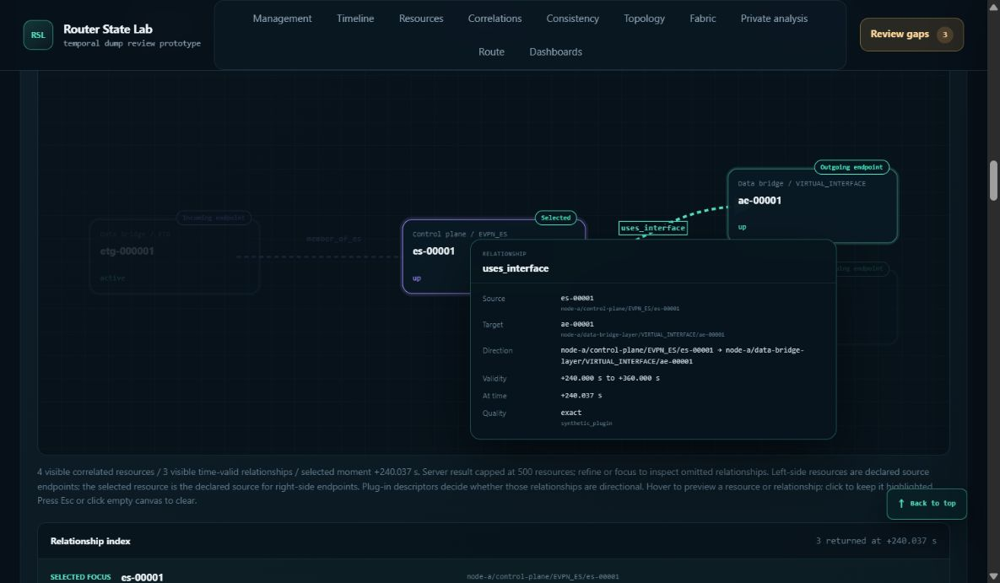

# Historical routes and resource correlations: fourth audit repairs

Date: 2026-10-23; browser observations continue into October 24 UTC. Base commit: `4f49279e9192709aa81b5fa305b69051708d4e51`, branch `codex/comprehensive-router-dump-demo`.

This change addresses the three findings in the [fourth 100-move audit](../history-correlation-100-browser-audit-v4-2026-10-23/README.md). It repairs startup readiness, interface display names, and graph resize behavior through the existing lifecycle and rendering paths. The slow cursor updates were profiled separately; no speculative backend cache or new plug-in API was added.

## Root causes and repairs

| Finding | Root cause | Repair |
| --- | --- | --- |
| H4-1: early node controls lose context or ignore actions | The range form and other controls were actionable before asynchronous bootstrap and timeline loading reached `bindControls()`. An early submit therefore performed native GET navigation. | The workspace starts `inert` and busy; review buttons outside it start disabled. Initialization releases the controls after handlers bind, without waiting for optional panels. The failure path releases the workspace after binding its Retry button. |
| H4-2: slash-containing interface names become suffixes | Two producers treated resource IDs as paths and selected their final slash component. | Packed resource normalization prefers the declared interface name and preserves the local interface name in the plug-in-owned fallback. Route egresses use labels already declared by the revision's topology projection, falling back to the complete opaque ID. The frontend remains generic. |
| H4-3: graph resizing loses keyboard focus and a valid popup | The resize handler called a full renderer, which closed the popup and replaced its focused SVG subtree. | The existing geometry work is shared by full rendering and a resize-only path. Resizing updates the existing paths, labels, and view box, then repositions the existing popup. Semantic changes retain their normal redraw and dismissal behavior. |

The route label map contains only the existing revision projection's declared labels. It does not retain another event history, perform resource queries for each route row, or parse device IDs in the frontend.

The sample archive was not regenerated: its source records and declared topology labels already contain the full names. The defect was in runtime normalization/presentation. All measurements use `router-state-lab-history-correlation-2026-10-23.tgz`, 286,504,605 bytes, SHA-256 `5f204e5836be8966f148ae14671f9488007970619cff094cc9bda60c71892105`. PE-A contains 1,250,005 events and 7,510 resources.

## Browser validation

The primary agent used the actual updated localhost demo and in-app browser. Checkpoints distinguish intermediate states from settled results; they are not 100 new independent tests.

- Cold bootstrap: native pointer attempts on Apply range and Collapse, plus Enter after attempting to focus the range input, did not submit the unbound form or remove the node/context query. The workspace remained busy and excluded from keyboard focus. Normal range submission worked after startup completed.
- PE-A's `Ethernet1/1.310` appears in full in the searched resource table and focused correlation graph at the historical cursor.
- A focused ES1 `uses_interface` edge remains keyboard-focused after resizing. Enter and Space activate the popup. A height-only change from 474×546 to 474×700 preserves the visible popup; settled width changes between 1100 and 1200 pixels retain the pin and update its position. Repeated width changes and pointer activation were exercised.
- Resizing while the resource-search field owns focus preserves that external focus. When reflow or scrolling moves the graph off-screen, hiding its popup remains intentional clipping behavior; this must not be misclassified as loss of a visible valid popup. Early activation attempts before the graph was visible are retained as preparation, not passing popup tests.

- P2's `Ethernet4/1` appears in full in both its table and focused graph. Edge-C's nine IPv4 route rows show `Ethernet1/1` as their egress label, alongside the unchanged canonical ID. A route row seeds the expected Edge-C-to-PE-A endpoints; after the node roundtrip, the trace resolves through PE-C and P2 at the preserved capture.
- ES1 has three relationships immediately before native +240.037600000s, five at the exact attachment instant, and three again after rewinding one nanosecond. Collapse/expand and all/focused scope roundtrips still work.
- A second cold entry on P2 uses the final markup: both header and footer review controls start disabled and the workspace is inert. Once ready, the footer opens and closes the review panel. Returning to fabric preserves its absolute capture and seeded route parameters.
- The temporary viewport override was reset. The bounded warning/error console query returned no entries. Startup failure/retry is covered by an executable unit test; a browser failure-to-success replay was not performed. Locator retries and early popup attempts before targets were visible are retained as preparation rather than successful assertions.

## Automated validation and skill trial

- `npm --prefix frontend run check`: **640 passed, 0 failed**, including frontend contracts, in `frontend-check-host-complete.log`. The suite was rerun after the footer readiness correction.
- Focused packed-resource normalization and generated route-egress tests: **7 passed**, in `label-checks-host-verified.log`. These include slash/subinterface names, declared-name preference, typed keys/state, legacy rows, and missing-label opaque-ID fallback.
- Both updated skills passed `quick_validate.py`. The plug-in conformance inventory command passed; this is an inventory check, not a claim that the complete conformance suite ran.
- An independent GPT-6.1 Sol trial used the updated validation skill with current source/tests, excluding earlier audit reports and parent evidence. It found no confirmed scoped startup/graph defect and passed 12 focused tests. Its sandbox full-suite attempt recorded 629 passes and 11 loopback-denial failures; the parent's subsequent authorized host run passed all 640. The trial did not use a browser, and its limitations are preserved in the evidence.

Earlier Python attempts included test-oracle mistakes corrected before the final seven-test run; those failed attempts are retained and are not product defects. An earlier stalled sandbox test process was stopped after its identity was verified. The final host run completed in 14.743 seconds. A Starlette/httpx deprecation warning did not fail the tests.

## 1M memory and CPU rerun

The unchanged 52-phase workload ran in a fresh Python process with a fresh search cache, against the same archive as the v3 baseline. Memory sampling and process high-water counters exclude the browser; OS caches were not flushed. All **52 ordered phase results**, **35 ordered page digests**, and **five invariant groups** match. An independent review checked the raw records in addition to the comparator.

| Metric | v3 baseline | v4 rerun |
| --- | ---: | ---: |
| Loaded process RSS | 2.176380 GiB | 2.175423 GiB |
| Lifetime peak RSS | 2.254776 GiB | 2.254967 GiB |
| Lifetime peak private commit | 2.248905 GiB | 2.248951 GiB |
| Sum of measured phase CPU | 152.968750 s | 187.546875 s |
| Overall elapsed | 157.703 s | 196.750 s |
| Search sidecar size | 75,038,720 bytes | 75,038,720 bytes |

Memory and storage are effectively unchanged in this pair. **CPU increased 22.60% (+34.578 s)** and elapsed time increased 24.76%. First event search/projection (+9.953 CPU seconds), switching to node B (+9.188), and returning to A (+9.797) account for 83.69% of the CPU increase.

The harness does not execute frontend JavaScript or request the lazy route provider. Its six recorded core source hashes are unchanged. The resource-label adjustment executes per resource, not per event. A bounded interleaved HEAD/current helper probe measured complete record construction at an estimated 19.882 → 20.106 ms per 7,510 representative rows; its direct overhead is far below the approximately nine-second changes. This probe is not an archive-weighted allocation/GC profile and cannot exclude indirect effects.

**The overall CPU increase remains unattributed.** These are historical runs, not a same-session interleaved A/B experiment with a fixed hash seed and recorded CPU frequency/thermal/contention data. It would be unsupported to call the increase either a confirmed patch regression or environmental noise. A paired run preserving the load/search/release/GC sequence is the next attribution step. This repair does not claim CPU improvement.

## Why historical cursor updates are slow

The separate direct-service investigation used eight native offsets, two rounds with reversed query order, and 128 timed component occurrences. Fresh cases clear the timestamp search-document cache while keeping expanded histories warm. Complete response digests matched across 64 identical-repeat pairs, 64 cross-round pairs, and all four separately profiled calls; all 33 unique compressed response archives were rehashed and parsed.

| Component | Fresh median elapsed | Identical repeat median | Fresh median CPU |
| --- | ---: | ---: | ---: |
| Searched DTE resource page | 1.62204 s | 0.003059 s | 1.58594 s |
| Empty-search 500-row DTE page | 0.09727 s | 0.09350 s | 0.09375 s |
| Focused correlation graph | 0.02744 s | 0.03115 s | 0.03125 s |
| Two default live dashboards | 1.21461 s | 1.22728 s | 1.15625 s |

The dominant measured work is population-wide safe search projection and repeated dashboard state reconstruction. The searched-page profile visits 7,510 resources and performs 1,252,040 interval checks. The dashboard profile reconstructs 7,125 resource states and performs 1,250,200 interval checks, with substantial disclosure/redaction work. A 500-row display limit does not bound this population work. Dataset lookup accounts for only 0.160 instrumented seconds in the dashboard profile, so reusing that lookup alone would address a small part of the cost.

The first lazy all-resource search took 7.09636 seconds and raised RSS from 2.17490 to 2.76057 GiB (+599.73 MiB). The largest query-boundary snapshot was 2.779202 GiB. These are snapshots from a different workload, not replacements for the 1M navigation benchmark's sampled/lifetime memory figures. No allocation profile attributes the increase among expanded histories, documents, and allocator retention.

High-fanout graph cases took 267–328 ms fresh, versus 3–35 ms for ordinary cases. Their profile contains 504,120 relationship-presence checks. One repeated dashboard outlier took 3.93646 seconds with matching output; without GC instrumentation, its cause remains unproven. Direct-service timings exclude HTTP scheduling/serialization and browser rendering and must not be summed into a claimed browser latency. The investigation reproduces costly computation, not a demonstrated persistent cursor stall.

## Evidence and documentation stewardship

- [evidence.zip](evidence.zip): browser checkpoints/screenshots, test logs, skill trial, cursor responses/profiles, raw benchmark results/samples, comparison, and attribution review.
- [evidence-manifest.json](evidence-manifest.json): archive and entry SHA-256 verification.

The author and validation skills plus `docs/plugin-api-validation.md` now cover startup readiness/native submission, geometry-only target preservation, independent width/height checks, external focus, and labels versus opaque IDs. The independent trial's validation-skill SHA-256 is `32AFA5DAFAFEFDF7223B4C748830D82F25BA7C2553ADF6DE9592419FD7BFDCE8`; final skill hashes are retained with the evidence.

The mandatory plug-in-documentation drift check is complete: these fixes restore existing display and lifecycle behavior without changing public discovery, manifests, capability contracts, identity, hooks, HTTP schemas, or author commands. No quickstart, normative contract, runnable example, README link, or architecture update was required. The pre-existing generated-archive lock file is preserved. No commit or push was performed during the repair task.

The updated demo remains running on `127.0.0.1:8883` as PID 9620, with its command line and listener identity recorded. The final resolved historical route tab remains open for inspection.
