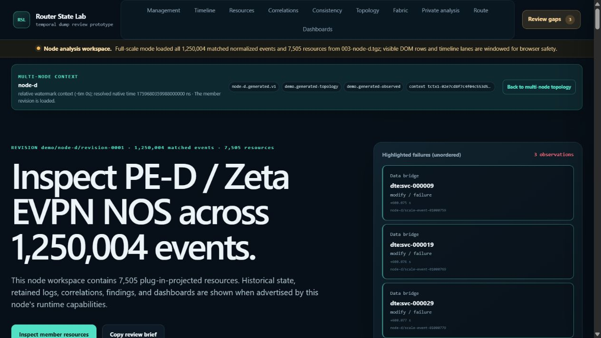

# Historical navigation and VPN focus repairs — round 5

Repairs the three findings in the [round-five browser audit](../history-correlation-100-browser-audit-v5-2026-10-23/README.md). Changes are based on `d29f98102f8d2a355d93209cd192c59de5916d35`. No commit or push is included in this task.

## Root causes and changes

| Finding | Root cause | Repair |
| --- | --- | --- |
| H5-1: UTC navigation crosses a deletion boundary | Node startup interpreted the original UTC selector as native time. | Workspace bootstrap reuses the existing projection selector and clock resolver, returns a separate scoped `resolved_time`, and initializes the cursor from `local_time_ns`. Absolute links retain the original UTC domain. |
| H5-2: relative navigation opens at capture | The relative offset was displayed but never resolved for startup. | The same metadata resolution applies the offset to the selected projection watermark. Startup no longer substitutes capture for a resolved relative instant. |
| H5-3: first VPN popup activation disappears during smooth focus scrolling | Clipping dismissal cleared the trigger before the browser finished revealing it. | The existing focus handler finishes an intentional off-screen reveal before opening the preview. Existing pinning, clipping dismissal and passive-focus suppression remain in use. |

The navigation resolver does not run a topology projection or create a second clock algorithm. Revision mismatches return 409 before client-dataset loading; invalid selectors remain errors. Missing clock mappings never turn UTC into native time. Ordinary workspaces without a requested time basis still open at capture and do not require topology support. The banner separates requested and resolved time and discloses unresolved or clamped navigation.

## Browser validation

Used the existing 286,504,605-byte history/correlation fixture on the local demo, port 8883. SHA-256: `5f204e5836be8966f148ae14671f9488007970619cff094cc9bda60c71892105`. PE-D has 1,250,004 events and 7,505 resources. No fixture regeneration was needed because producer behavior is unchanged.

| Reproduction | Observed result |
| --- | --- |
| Fabric UTC `1759680179993000000`, then open PE-D and search `Ethernet1/1.310` | Native cursor `1759680179985000000`, displayed offset +179.993 s. Fabric attachment is usable; node resource is **Exists yes / up**, before its +180 s deletion. |
| Fabric watermark −120 s, then open PE-D | Native cursor `1759680599988000000`, displayed offset **+599.996 s**, not +720 s capture. |
| Return to fabric, change to watermark −360 s, then reopen PE-D | Native cursor `1759680359988000000`, displayed offset **+359.996 s**. The 4 ms difference from a naive capture subtraction preserves the declared projection watermark. |
| Settled blue VPN trace; focus Focused path, scroll up while retaining focus, native Tab then immediate Enter | Correct service popup opens on the **first** activation and remains open after focus scrolling settles. |
| Repeat with immediate Space | Correct service popup opens on the first activation. |
| Scroll the pinned service strip completely out of view, then back | Popup dismisses and does not revive. |

The popup checks used native keyboard input in the real browser, not DOM-dispatched events or simulated rectangles. Navigation checks ran after restarting the backend with the repaired code. Browser console warning/error query returned no entries at the end of validation. This is not an exhaustive network-error audit.

[Pre-deletion resource state](absolute-node-before.png) and [first-Enter VPN popup](popup-first-enter.png) provide the other visual checks. Full DOM observations and keyboard-control results are retained with the evidence.

## Automated validation and skill maintenance

- `npm.cmd --prefix frontend run check`: **648 passed, 0 failed**. The initial sandbox run's proxy tests failed with localhost `EACCES`; the same suite passed with local loopback access.
- Nine focused Python integration tests passed, covering mapped UTC, projection watermarks, unresolved clocks, invalid selectors, stale revisions, ordinary workspaces and load tracking. The strengthened class-level no-topology-query regression also passed separately.
- `python scripts/export_type_stubs.py --check`: **149 module stubs verified across four packages**. Workspace-local TEMP/TMP and UTF-8 mode resolved Windows environment failures in the preliminary attempts.
- Both updated skills passed `quick_validate.py`; conformance inventory listing passed. Inventory is not a claim of full behavioral conformance.
- A fresh **GPT 6.1 Sol** agent used the changed validation skill with a short task prompt and no inherited diagnosis. It passed 23 focused route tests, identified the native-focus coverage limit correctly, and made no product changes. The parent supplied the actual browser validation above; the agent was prohibited from using the browser.

The author/validation skills and API validation map now require original-versus-native time checks, selected-watermark validation, native first-activation controls and honest performance coverage. The core workspace HTTP envelope is documented in [API contract §1.1](../api-contract.md#11-browser-workspace-bootstrap).

**Documentation drift check completed:** no plug-in hook, parser, manifest, resource identity, author command or example behavior changed. The maintained quickstart, plug-in contract and runnable example therefore need no churn. The additive core HTTP metadata and revision selector are documented, with focused integration and type-stub checks covering them.

## Measurements and remaining cursor cost

The demo was stopped during the sequential quiet runs; browser navigation and test suites did not overlap them. The unchanged 1M harness uses a fresh process and search cache, samples process memory every 100 ms, and retains lifetime counters. OS file caches are not flushed. Browser/GPU memory and end-to-end UI latency are outside this measurement.

| Metric | Prior quiet run | This run |
| --- | ---: | ---: |
| Loaded RSS | 2.1754 GiB | 2.1760 GiB |
| Lifetime peak RSS, including navigation | 2.2550 GiB | 2.2560 GiB |
| Lifetime peak private commit | 2.2490 GiB | 2.2513 GiB |
| Sum of all 52 measured phase CPU times | 187.547 s | 159.984 s |
| Workload elapsed time | 196.750 s | 166.672 s |
| SQLite sidecar | 75,038,720 bytes | 75,038,720 bytes |

All **52 ordered phase results**, **35 page digests**, and **five invariant groups** match. Storage remains `sqlite-zlib-blocks-v1`. The historical CPU difference is −14.70%, but the measured loader/search implementations have unchanged source hashes; these functional repairs do not establish a causal speedup. This direct-service workload is a regression check, not a timing of the new workspace HTTP clock-resolution envelope. That envelope is covered by integration tests and browser navigation.

The separate cursor workload reuses the prior PE-A cases: eight native offsets,
500-row DTE pages with search empty/active, a focused correlation graph, and two
default-open dashboards, in two query-order rounds. It contains 128 timed
occurrences; all 64 exact-repeat pairs, 64 cross-round pairs, four separately
profiled outputs and 133 ordered response digests against the prior run match.

| Component | Fresh timestamp median wall / CPU | Exact repeat median wall |
| --- | ---: | ---: |
| Resource page, empty search | 97 ms / 94 ms | 97 ms |
| Resource page, active search | 1.643 s / 1.594 s | 3 ms |
| Focused correlation graph | 30 ms / 31 ms | 28 ms |
| Two default-open dashboards | 1.179 s / 1.156 s | 1.197 s |

The separate first lazy searched cursor took **7.226 s wall / 7.156 s CPU** and
grew RSS by **600.6 MiB**. The largest query-boundary RSS snapshot was
**2.7770 GiB**, not a sampled lifetime peak. This workload materializes historical
resource state and dashboard populations that the 52-phase event-search/navigation
workload does not. The repeated dashboard outlier of **3.893 s** is retained;
the table reports medians, not a bound on every update. High-fanout graph cases
reach the 500-node limit and take around 260–291 ms.

The remaining cursor cost is population-wide work: active resource search projects
safe searchable text across 7,510 resources before page/kind filtering, while the
dashboards separately reconstruct 7,125 states. Existing interval lookup scans
histories to preserve overlapping and perspective-qualified semantics. A small
rendered page does not cap this work. The existing searched-timestamp cache helps
exact repeats but does not avoid fresh-cursor projection; dashboard population
reconstruction repeats even at the same timestamp.

Followed topology was measured in its own fresh process with the current UI's
bounded defaults and a new request-owned temporal service for every query. It
passed 32 occurrences, 16 exact-repeat pairs, 16 cross-round pairs, separate
profile equality and nine verified response archives. Median cost was
**1.247 s wall / 1.203 s CPU**, with **1.252 s** wall for an exact repeat.
The first lazy query took 1.366 s and added about 83.5 MiB RSS. In the separate
4.777 s instrumented profile, relationship reconstruction took 2.354 s and
465,674 presence checks; change extraction took 1.262 s and uncertainty/state
reconstruction 1.073 s. Those nested times overlap. Creating the service itself
was negligible: retaining the service object alone would not remove this work.

Followed topology also had a 3.975 s wall / 3.750 s CPU repeat outlier;
the dashboard outlier used 3.766 s CPU. These are real process-work spikes,
not purely idle observation gaps. Their exact cause remains unassigned because
GC, allocation and cleanup were not instrumented. The evidence does not establish
a permanent stall or memory leak.

These isolated component timings are not additive UI latency estimates. The
prior browser audit's long follow-up observation gaps are not response timings;
queueing, HTTP serialization and rendering are not measured here.

No speculative cache was added for this investigation. The next material target
is interval lookup and repeated safe-state projection, with an ordered/disjoint
fast path only where those properties are proven. Overlapping perspectives,
unknown/deleted presence and boundary semantics must retain the existing behavior.
The small repeated dataset/descriptor lookups are secondary to the measured scans.

The first benchmark attempt used an overly deep task-local temporary directory. SQLite rejected its 272-character temporary sidecar path with `unable to open database file`, and the existing fallback built an in-memory index. A shorter filename in the same root (223 characters) and the normal filename in a shorter root (178 characters) both succeeded. This is a measured Windows path-length limitation, not a demonstrated permissions failure. That diagnostic run is retained separately and excluded from baseline memory/CPU comparisons; the comparable rerun uses a short task-local cache root. The product's in-memory fallback behavior is unchanged.

## Evidence and handoff

- [Detailed performance analysis](performance-analysis.md) includes source attribution, outliers and scope limits.
- [Evidence archive](evidence.zip): 131 files, 991,131 bytes; every entry was read back and SHA-256 verified. The [manifest](evidence-sha256.json) records all entry hashes and archive hash `60c9fca965a75deb8891f6ace8bf2b334a8c182afd3851d9c5beebe8a68b61b3`.
- Archive paths preserve repository-relative layout, including the original measurement scripts and baseline JSON. Reproduction requires the source checkout and the original fixture identified above. Temporary unpacked files and large search sidecars are excluded.
- The demo was restored at `http://127.0.0.1:8883`, PID 23584. The inspected node page is retained for the user. No commit or push was performed.
