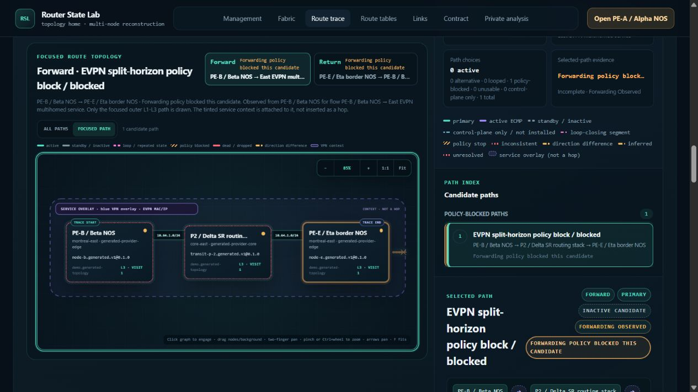
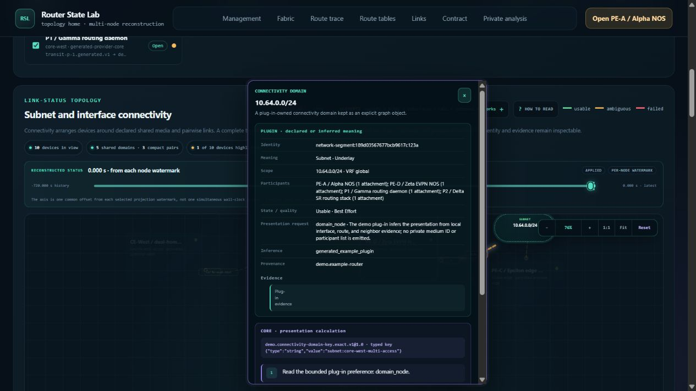

# Route/topology audit repairs — 2026-10-23

This change fixes the six functional findings from the
[route/topology audit](../route-topology-browser-audit-2026-10-22/README.md)
and the [100-move audit](../surrounding-100-browser-audit-2026-10-22/README.md).
It also reduces repeated route-trace work by reusing source-path resolution
within each executable-identity attestation. The original reports and evidence
remain unchanged; this report records their disposition and the new validation.

## Functional repairs and browser evidence

| Finding | Root cause and existing logic repaired | Browser validation |
| --- | --- | --- |
| RT01: inspector outlives its visible anchor | Fabric inspector placement bounded only the card against the window. It now intersects the anchor with its graph viewport, window and sticky header. Existing graph transform, drag and scroll paths reconcile placement and dismiss fully clipped or disconnected anchors. | A partly clipped subnet retained its card; further keyboard pan dismissed it. Fit did not revive it. Page scrolling behind the sticky header dismissed the pin and surrounding navigation remained usable. |
| RT02: focused policy-stop glyph missing | The SVG marker reused the resolution select's `mn-route-policy` ID. Focused edges now refer to the unique `mn-route-policy-stop` marker; the existing marker CSS covers it. | The focused policy block showed the stop glyph. Forward/Return and Focused/All paths were repeated. DOM inspection found the select and marker under distinct IDs and the blocked edge referenced the marker. |
| RT03: direction/status overlap | The grid allowed the direction label to shrink to zero while its status retained intrinsic width. The label now has its own automatic column; the status occupies the shrinkable column and wraps. | Forward and Return labels measured 46.19 and 39.59 pixels wide, with an 8-pixel gap before each status. Long policy status wrapped without overlap. |
| RT04: VPN links detached from cards | Shared layer CSS stretched the SVG above its declared height, causing SVG aspect-ratio centering absent from the HTML layer. Removing those minimum dimensions lets both existing layers use their explicit layout dimensions. | At 1:1, both layers measured 1396 × 524 pixels with identical origins and transforms. Dragging PE-A preserved that equality. Reset and Fit were also checked visually. |
| S100-01: pinned inspector steals filter focus | Passive restoration called the activation path, which always focused Close. Restoration now records focus ownership and restores it only when the inspector owned it. Passive same-anchor re-entry also preserves inspector-owned focus and scroll. | With both the pin and filter visible, separately typing `p` and `1` retained `mn-node-filter` focus, produced `p1`, and kept the pin visible. The clipped-anchor variant also retained typing focus while correctly dismissing the card. |
| S100-02: Back restores text but not filtering | Browser form restoration bypassed input events, leaving visible text inconsistent with the authoritative filter state. Existing route-table rendering now reconciles text controls as it already reconciled selects; a deferred `pageshow` render covers history restoration ordering. | A one-route filter followed by Management → actual browser Back settled with all three controls consistently cleared and 693 routes. Retyping reapplied filtering; Clear restored all rows. Retained-state behavior is covered by the frontend regression test. |

These repairs change presentation, focus ownership and filter consistency. They
do not alter plug-in route decisions, topology claims or routing semantics.
The browser used the synthetic 1,250,005-event fixture at a 1265 × 720 viewport.
UI interaction drove the checks; rendered-DOM reads recorded values, focus and
geometry. Source inspection and mocked geometry tests supplement the browser
evidence rather than replacing it.

Additional screenshots show [aligned VPN layers](vpn-one-to-one.png),
[a dismissed off-screen pin](pin-dismissed.png), and
[consistent route filters after Back](filter-after-back.png).
The evidence archive includes the complete timestamped browser observations and
the measured rectangles, not only the selected screenshots.

## RT05: repeated route CPU cost

The baseline profile traced the repeated cost to executable-identity validation:
many functions in the same source file independently resolved that path through
Windows filesystem operations. A profiled repeated bidirectional loop trace made
12,960 `Path.resolve` calls; `_resolved_source_path` accumulated 5.77 seconds.
Profiling adds overhead, so these figures identify work rather than representing
ordinary request latency.

The existing identity budget now retains at most 2,048 exact tuple/string path
resolutions for one attestation. A separate final-pass cache resolves those paths
again. Individual module/object provenance checks, source-byte and file-identity
rereads, live runtime-state checks, and pre/post invocation validation remain.
Independent attestations do not share resolved paths; dynamic string subclasses
bypass this reuse. There is no persistent executable-trust or route-result cache.

A direct, unprofiled comparison used fresh processes and source snapshots from
this session, with three unchanged warm repetitions of the same bidirectional
loop query. Timing includes the direct provider operation; it excludes browser
transport and rendering.

| Repeated route measure | Before | After |
| --- | ---: | ---: |
| Median wall time | 9.346 s | 5.150 s |
| Median process CPU | 8.750 s | 4.766 s |
| `Path.resolve` calls in separate diagnostic profiles | 12,960 | 960 |
| `_resolved_source_path` cumulative profiled time | 5.773 s | 0.406 s |

The measured medians fell about **44.9% in wall time and 45.5% in CPU**.
All first/repeated route response hashes matched, including the 2,903,161-byte
serialized response. This demonstrates improvement in the measured direct-route
path; it is not a claim that every browser operation is 45% faster. The route
still performs several seconds of work and is not treated as free or fully
optimized.

## S100-P01: loading investigation and remaining cost

The preceding browser audit observed PE-A readiness at an upper bound of
72.611 seconds, with 59.328–59.813 server CPU seconds. That was a process-wide
window containing several requests, not an isolated loader measurement.

A separate baseline probe in this session separated these costs:

| Probe phase | Wall | CPU |
| --- | ---: | ---: |
| Archive preparation | 22.207 s | 21.438 s |
| PE-A cold dataset load | 34.577 s | 33.875 s |
| Client dataset envelope | 0.058 s | 0.047 s |
| Three-failure preview | 0.549 s | 0.547 s |
| Initial timeline | 0.392 s | 0.391 s |
| Initial resource graph | 0.831 s | 0.828 s |
| Initial resource rows | 0.489 s | 0.469 s |
| All-dashboard query | 7.211 s | 7.141 s |
| Topology capabilities | 2.318 s | 2.266 s |
| Initial topology query | 0.636 s | 0.609 s |

The cold-load diagnostic profile is dominated by the scale loader's 1,250,005
event compactions, JSON parsing, field lookups and integer/value normalization.
The lightweight client envelope is not the main cost. Archive preparation and
event materialization remain substantial work after the identity optimization.

The all-dashboard probe deliberately requests all four dashboards. It is a
direct API diagnostic, **not an exact replay of the browser's dashboard selection
or concurrency**. Its sequential phases must not be summed and presented as
browser load latency. Its roughly 2.82 GiB peak also belongs to that broader
diagnostic workload, not the standard navigation benchmark below. The profile
locates cost centers but does not fully attribute the original 59-second window;
no loading-regression claim is made from that unmatched observation.

Source inspection explains why opening Fabric still materializes a large node:
[`demo/rsl_demo_plugin/session.py`](../../demo/rsl_demo_plugin/session.py)
loads the default revision before building topology metadata.
[`topology_contract.py`](../../demo/rsl_demo_plugin/topology_contract.py) reads
its revision, capture and timeline bounds from the loaded dataset. That requires
PE-A's full event history even for a topology-first visit. Other node packs are
streamed to validate their projection members; the evidence does not show ten
full event histories being parsed.

The restarted browser server reached topology readiness with **90.203 process
CPU seconds accumulated since startup**. A separate direct after probe's import,
archive, cold-load, bootstrap, topology construction/query and route-construction
phases sum to 64.188 CPU seconds. Their **26.016-second difference is unassigned**:
the live CLI composition/deployment startup, request mix, serialization, progress
polling and unmeasured setup differ. It cannot be labeled measured validation or
composition overhead by subtraction. Live logs also contain route-capability and
two route-table requests; progress showed one PE-A parse followed by provider
validation. No evidence here establishes repeated default-node loading or a cold
search-index build during this initial Fabric load.

A next optimization candidate is to derive the same topology time bounds from
independently validated bounded pack metadata, removing the default-history
dependency in the demo adapter. It is not implemented in this repair, and no
savings are claimed for it. Exact identity, time-bound and malformed-metadata
tests would be needed before replacing the current source of those bounds.

## Fresh 1M-plus memory and CPU rerun

The final standard run used all **1,250,005 events and 7,510 resources**, a fresh
process and search cache, and 52 phases covering initial loading, dense/refined
searches, pages, zoom densities, locate operations, node switching and reopening.
The OS file cache was not flushed. Windows process RSS/private commit and CPU
were measured; these are not browser renderer measurements.

The comparison column is the previous task's final run, not a contemporaneous
paired baseline. Its 159 Python source texts match this task's baseline after
CRLF/LF normalization; exact checkout byte hashes differ. The after snapshot
contains the identity change and matches the working-tree Python source text.
This qualification permits correctness and memory comparison, but does not
establish broad causal speedups from one historical timing pair.

| Standard 52-phase measure | Historical baseline | Current run |
| --- | ---: | ---: |
| Loaded RSS | 2.1742 GiB | 2.1748 GiB |
| Peak RSS | 2.2542 GiB | 2.2524 GiB |
| Peak private commit | 2.2483 GiB | 2.2470 GiB |
| Sum of phase CPU | 185.406 s | 178.734 s |
| Harness elapsed time | 189.766 s | 183.953 s |
| Search sidecar | 75,038,720 bytes | 75,038,720 bytes |

All **35 complete page hashes and all 52 phase result summaries matched**.
Cache retirement, shared search-cache and validation-cache records also matched.
The current run retained at least 28.93 GiB of available host RAM. Memory and
storage remain effectively unchanged; the historical timing differences are
reported as observations, not attributed to this optimization.

Fixture: `demo/fixtures/router-state-lab-algorithms-2026-10-02.tgz`,
286,496,584 bytes, SHA-256
`4cea20db78aa3fede9dc79a89a9277c5a9a72905fbff76a5f8436efd1c4aec30`.

## Validation and skill stewardship

- Final `npm --prefix frontend run check`: **607 passed**, no failures or skips.
  This includes frontend source checks and the new history, inspector-focus,
  clipping/scroll and marker regressions. Browser checks cover the CSS geometry.
- Identity suites: **112 unique tests passed**. Five Windows junction cases were
  initially skipped under the restricted environment; rerunning their 20-test
  module on the host passed all 20 with no skips. The rerun overlaps the unique
  count and is not counted as 132 distinct tests.
- Ruff passed. Generated stub export checks passed for 149 modules; public and
  package typing passed for two and 149 files, respectively. Earlier restricted
  temporary-path attempts are retained as diagnostic logs, not passing results.
- The independent skill trial selected and ran nine identity checks plus four
  composed mutation checks: **13 passed**. Its conformance declaration inventory
  also passed; an inventory listing is not execution of all conformance groups.
  Trial inputs excluded parent diagnostics, old audit reports, other agents'
  outputs and prior artifacts. The recorded prompt and skill hashes accompany
  its reports. It did not reproduce a source-path retarget inside an actual route
  invocation, so that specific combined case is not claimed as tested.
- Independent code review found a passive same-anchor re-entry focus regression
  during implementation; the final change preserves inspector-owned focus and
  scroll, with a corresponding regression assertion. The subsequent identity
  review found no concrete regression in cache lifetime or final revalidation.

The [validation skill](../../.agents/skills/router-plugin-validate/SKILL.md),
[authoring skill](../../.agents/skills/router-plugin-author/SKILL.md), and
[API validation map](../plugin-api-validation.md) now guide passive restoration,
history/control consistency, layered geometry, profiling boundaries and bounded
source-path reuse. These are validation and implementation guidance changes.

Plug-in documentation drift check completed: no discovery, manifest, capability,
input, parsing, resource identity, event/reducer, provider, topology/route semantic,
public command or runnable-example contract changed. The optimization preserves
the existing executable-identity contract. Consequently the quickstart, normative
contract, runnable example, README author links and public API/architecture
documents require no new authoring instructions.

## Final integrated browser/load check

After restarting the server with the backend change, the browser ran the
bidirectional forwarding-loop scenario, opened the million-event PE-A workspace,
selected the DTE lane and failure, and returned to Fabric. The selected failure
`node-a/scale-event-01000759` restored the DTE `dte-000009` lane, increased visible
lanes from 13 to 14, and settled at +600.075 seconds. The loop completed again
through a verified native submit. Two earlier automated clicks did not issue
a POST and left the empty-route prompt visible; it was an inconclusive activation
attempt, not an additional confirmed defect. The destination label `node-b` is
intentional in the generated contract and native submission accepted it.

Process boundaries recorded 6.094 additional CPU seconds between topology-ready
and loop-complete, then 20.078 seconds between loop-complete and node-ready.
These broad UI windows include multiple requests. RSS rose from 2.215 GiB after
the loop to 2.818 GiB at node-ready. PE-A's history was already loaded; the
separate all-dashboard probe illustrates a source of additional materialization,
but its different request scope prevents assigning the entire live increase to
dashboards. The standard 52-phase memory result remains a different workload.

The first visible-node timestamp is not the completion time of all secondary
requests. The sampler also began after reload had started, so it cannot isolate
early startup CPU. No browser console warning or error was captured.

The final EVPN split-horizon scenario completed with the expected policy-blocked
outcome in both directions. Its [final screenshot](new-backend-policy-focused.png)
shows the orange stop glyph and readable direction/status labels. The
[million-event node screenshot](new-backend-node-timeline.png) records the selected
failure and lane. The local server remains running for review.

## Reproduction and evidence

The compact [evidence archive](evidence.zip) contains scripts, result JSON, CPU/memory samples,
test logs, skill-trial reports, browser observations and selected screenshots.
It excludes source-tree copies, fixture archives, caches, SQLite files and temp
directories. [Portable reproduction instructions](REPRODUCE.md) and a result
checker accompany the archive. Raw historical paths inside logs remain
provenance, not required checkout locations. The
[SHA-256 manifest](evidence-manifest.json) records every archive member and the
report's companion files, including the integrated browser/load evidence.
