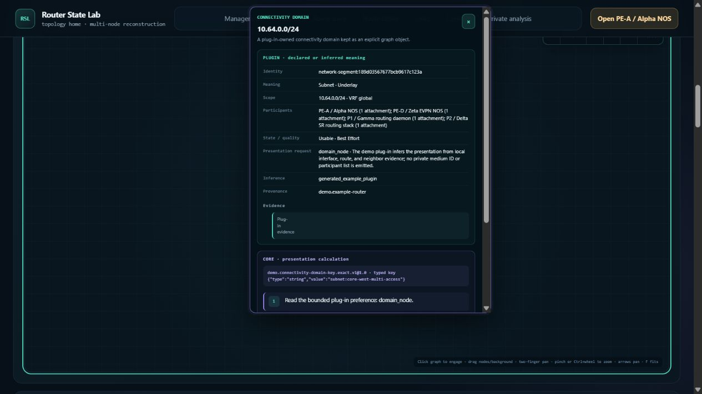
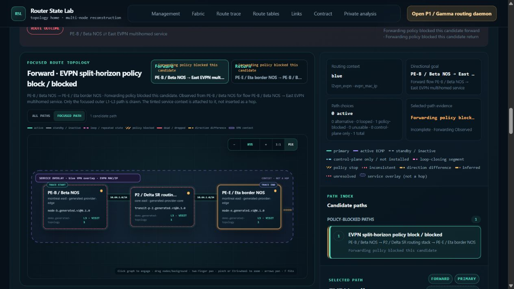
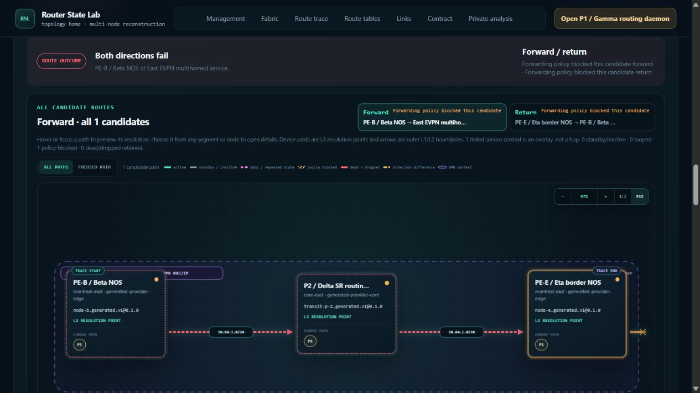
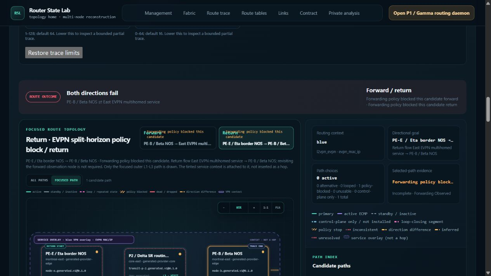
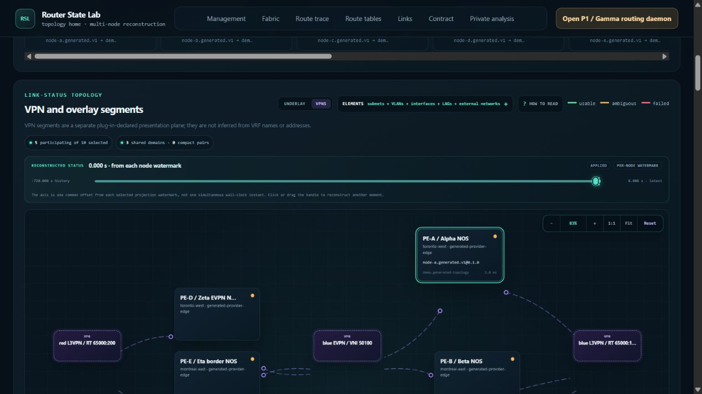

# Route trace and topology browser audit — 2026-10-22

This pass confirmed four functional defects and measured an expensive repeated
route operation. The functional findings remain open. No product code was
changed. RT02 adds confirmed visual impact to an ID collision noted previously;
the performance observation is not established as a new regression.

## Environment and method

- Baseline: `29c445a9211af56b18c3ca3910f06ca91b4dab6b`, branch
  `codex/comprehensive-router-dump-demo`.
- Live local demo: `http://127.0.0.1:8883`, server PID 29420, generated fixture
  `demo/fixtures/router-state-lab-algorithms-2026-10-02.tgz`. PE-A's node view
  reported 1,250,005 events and 7,510 resources.
- Browser viewport: 1265 × 720 CSS pixels. Ordinary pointer, keyboard, select,
  graph drag, zoom, pan, and navigation controls drove the exploration. DOM reads
  inspected rendered text and geometry; no state injection or direct API calls
  drove these checks.
- Ninety-four timestamped browser captures document the sequences below. These
  are observations, not 94 independent test cases. Server CPU and memory were
  sampled once per second during most of the pass.
- Repository validation skill used. The conformance inventory command
  `python -B scripts/check_plugin_conformance.py --list` passed; listing tests
  does not execute them. Frontend tests and the standalone 1M benchmark were not
  rerun for this documentation-only audit.

## Open functional findings

| ID | Priority | Finding | Reproduction evidence |
| --- | --- | --- | --- |
| RT01 | P2 | A pinned fabric inspector survives loss of its anchor and covers navigation. | Captures 19–22; clipped-anchor geometry and screenshots. |
| RT02 | P2 | Focused policy-blocked routes omit their stop glyph. | Captures 53–56; duplicate-ID DOM evidence; focused/all-paths comparison. |
| RT03 | P3 | Long policy status text overlaps Forward/Return labels. | Capture 57; zero-width direction-label geometry. |
| RT04 | P2 | VPN attachment ports and links are detached vertically from device cards. | Captures 68–71; drag, Reset, and 1:1 geometry. |

### RT01 — Pinned fabric inspector remains after its anchor leaves the graph

1. In Fabric → Underlay, show subnets and interfaces, with all ten members selected.
2. Pin the shared `10.64.0.0/24` subnet's calculated topology details using Enter.
3. Focus the graph and press ArrowRight 32 times, moving the subnet off the left
   edge. Try Fit and the sticky Route trace navigation while the card remains open.

The inspector remains fixed at x455.525, y12, width 440, height 560. Its anchor is
fully clipped: x−242.472 to −130.427 while the graph's left boundary is x44.8.
The card covers the sticky navigation and controls despite no visible anchor.
Closing it restores unobstructed navigation. The screenshot demonstrates the
obstruction; this report does not infer navigation state solely from a click
through the overlapping card.

The existing `positionTopologyInspector()` in
[`topology.js`](../../frontend/assets/topology.js) (line 6396 at this baseline)
clamps to the window but does not intersect the anchor with its graph/sticky
viewport. `applyGraphTransform()` (line 7138) and keyboard pan (line 7318) change
the transform without reconciling the inspector. Pointer pan and wheel handling
also retain pinned cards without repositioning them.

The earlier [off-screen popup repair](../frontend-topology-scan-repairs-2026-10-22.md)
applied to the timeline/log `positionHover()` path; this is the fabric inspector
path. Fixing its existing placement and transform handling should be evaluated
before introducing another popup subsystem.

### RT02 — Focused policy-stop marker collides with the resolution select ID

1. Run **EVPN split-horizon policy block** in both directions.
2. Inspect Focused view, switch to All paths, then return to Focused.
3. Switch to Return and inspect its focused blocked path.

The trace correctly reports a forwarding-policy block. Focused view omits the
terminal orange stop glyph; All paths draws it. Repeating the view changes
in Forward reproduces the difference. The Return focused path also has the
colliding marker ID; the full mode comparison was performed in Forward.

The rendered document contains both an HTML `select` and an SVG `marker` with ID
`mn-route-policy`. `getElementById('mn-route-policy')` resolves to the select,
while the focused blocked edge uses `marker-end="url(#mn-route-policy)"`.
All paths uses the distinct `mn-route-policy-all` marker and renders correctly.

The conflicting definitions are
[`topology.html`](../../frontend/pages/topology.html) line 365 and
[`topology.js`](../../frontend/assets/topology.js) line 9070; the focused edge
references that ID at line 9147. The existing marker definition, references and
marker CSS should share a unique SVG ID. This does not require changing route
semantics or the resolution control.

The duplicate ID was previously noted as an automation selector collision in
[case M213](../audit-600-2026-10-21/findings.md). This audit confirms its visible
product impact; an ambiguous automation locator alone is not the finding.

| Focused: missing stop glyph | All paths: visible orange stop glyph |
| --- | --- |
|  |  |

### RT03 — Policy status consumes the direction label's grid column

With the same bidirectional policy-blocked scenario at this viewport, the status
**Forwarding policy blocked this candidate** overlaps the Forward/Return labels.
Switching directions and Focused/All paths retains the overlap.

The Forward label's span has width 0 at x374.575, while its adjacent status has
width 171.9625 at x382.575. Return likewise has width 0 at x580.1375, beside a
167.2625-pixel status. The text remains painted outside its zero-width column.

[`topology.css`](../../frontend/assets/topology.css) line 1825 uses
`grid-template-columns: minmax(0, 1fr) auto`; the label permits zero minimum
width while the status column remains unconstrained (lines 1857 and 1876).
The existing layout needs to allocate readable space or wrap/truncate status
text. This differs from the previously repaired endpoint-label issue.

### RT04 — VPN SVG and HTML layers use different vertical coordinates

1. In Fabric, enable Subnets, VLANs, Interfaces, LAGs and External networks;
   leave Subinterfaces off.
2. Select the VPNs presentation plane. Five nodes participate in three domains.
3. Drag PE-A upward at approximately 83% zoom, then inspect its attachment ports
   and links. Reset the layout and select 1:1.

Ports and links sit below their device cards. PE-A's `nve-blue` attachment can
appear beside PE-B instead. Reset does not remove the displacement, so this is
not merely stale drag state.

At 1:1, the SVG viewBox and height attribute specify 524 units, but CSS stretches
its rendered height to 638.4 pixels. Default SVG aspect-ratio alignment centers
the drawing vertically, adding 57.2 pixels. The overlaid HTML cards receive the
same graph transform without that SVG-internal offset. At 83%, the observed
offset is approximately 47.4 pixels, consistent with that scale factor.

The PE-A card spans y441.025–557.125, while its `nve-blue` edge begins at
y618.775, beside PE-B's y581.025–697.125 card. Small horizontal port gaps are
intentional; the additional vertical displacement is the defect.

[`topology.js`](../../frontend/assets/topology.js) sets the SVG dimensions and
viewBox at lines 7725–7727 and the HTML node-layer height at line 8065.
[`topology.css`](../../frontend/assets/topology.css) lines 1731–1739 apply
`min-height: 100%` to the layers. Compact VPN layouts can be shorter than the
640-pixel stage. Correcting this existing coordinate contract is preferable to
compensating every edge or drag operation separately.

## RT05 — Repeating an unchanged warm loop trace remains expensive

Three consecutive submissions of the same **Cross-node forwarding loop** query,
with both directions selected, produced the following measurements:

| Repeat | UI operation wall time | Server CPU seconds, inner–outer sample windows | Peak CPU, one-core basis |
| --- | ---: | ---: | ---: |
| 1 | 6.223 s | 4.844–5.359 | 100.2% |
| 2 | 5.899 s | 3.641–4.813 | 93.9% |
| 3 | 7.272 s | 5.781–6.281 | 103.8% |

CPU sampling brackets the recorded UI timestamps; the outer window includes up
to one sample interval before and after each operation. UI times include browser
tool transport and completion polling, so they are not exact HTTP latency.
Server CPU is process-wide and includes periodic analysis-load polling. Browser
renderer CPU and memory were not measured. These limitations do not explain away
the independently observed several CPU seconds of work per repeated trace.

RSS changed only about 0.6 MiB across these repeats. The concern is repeated CPU
work and waiting, not demonstrated memory growth. This is an ongoing measured
cost; this pass has no matched before/after benchmark proving a new regression.

Static inspection identifies a profiling lead, not a measured attribution:
[`multi_node_route.py`](../../src/router_dump_analyzer/multi_node_route.py)
lines 6108–6109 run forward and reverse traces sequentially. A trace reuses its
selected snapshot at line 6222 but still queries route evidence at line 6285.
[`multi_node_topology.py`](../../src/router_dump_analyzer/multi_node_topology.py)
iterates members and projects evidence (lines 1293 and 1682); storing the result
map does not itself avoid a later query. Provider-result checks in
[`capability_router.py`](../../src/router_dump_analyzer/capability_router.py)
lines 887 and 905 are another candidate. Profile an identical bidirectional
repeat before deciding whether evidence reuse or validation work is the main
target; older compilation-cost profiles do not establish the current cause.

Across the wider 850.7-second observation window, 842 samples recorded 95.70 server
CPU seconds. RSS started at 2.835 GiB, ended at 2.876 GiB, and peaked at 2.882 GiB.
That 41.87 MiB net increase spans broad graph/node/lane work and is not evidence
of a leak. All 268 newly flushed access-log entries returned HTTP 200; stderr
had no new output and the browser console capture was empty.

## Other exercised sequences

- Nested VPN over VPN: both directions, service pin, graph zoom/pan and Fit;
  Forward showed four packet transitions and completed delivery.
- ECMP: selected P2 through the shared PE-A path selector in All paths, repeated
  Return→Forward three times, and retained the Forward path choice. Focused
  zoom, keyboard pan and Fit completed.
- Forwarding loop: selected and dragged P1 visit 1 and visit 2 separately;
  direction round trips retained distinct visit identities and positions.
- Strict and best-effort missing-resolution traces both retained honest
  incomplete outcomes; best-effort continuation did not claim proven delivery.
- Fabric layer changes and Underlay→VPN→Underlay→VPN preserved route context.
- Route tables: filtered to PE-A and `packet-vpn-over-vpn`, used its single
  matching route, and confirmed PE-A start, node-a source, node-b destination
  and Forward-only seeding. The trace completed.
- Opened PE-A from that trace; selected failure `node-a/scale-event-01000759`
  at +600.075 s on DTE000009; checked inspector identity; hid the lane and
  reselected the failure. The selected event remained correct. This sequence
  did not establish automatic restoration of a deliberately hidden lane.
- Repeated timeline zoom and Back, then node topology navigation retained the
  selected event and +600.075 s cursor.
- Returning to Fabric restored VPN plane, layer choices and seeded route
  context. The final rerun completed with four transitions and delivery.

The browser was left on that successful route, shown in
[the final screenshot](90-final-route.png). The server was not restarted.
Passive SVG hover ownership was not conclusively exercised because the available
automation focus path could not activate that target reliably. No defect is
claimed from that tool limitation. Member-set permutations, controlled request
races and exhaustive at-time reconstruction were outside this pass.

## Evidence and documentation check

[evidence.zip](evidence.zip) contains the timestamped browser observations,
rendered-DOM geometry, operation timings, server samples, aligned CPU windows,
console capture and log deltas. [evidence-manifest.json](evidence-manifest.json)
records the files, sizes and SHA-256 hashes. Screenshots are also available
directly beside this report. All data comes from the local synthetic demo.

Plug-in documentation drift check completed: only this audit report and its
evidence were added. Discovery, manifests, capabilities, parsing, identity,
events, providers, topology/route semantics, public APIs, author commands and
runnable examples are unchanged. No authoring-document or skill change is
needed for an observation-only audit.
