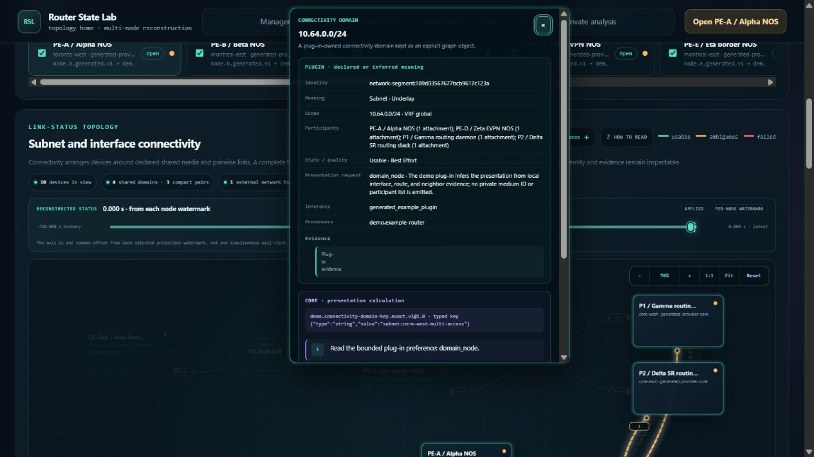
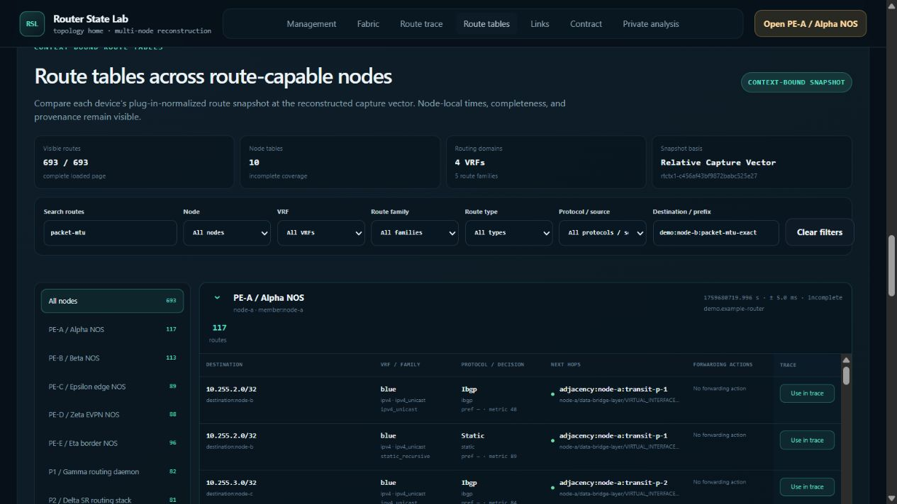

# Surrounding-component browser audit — 100 additional moves

This pass executed 100 numbered browser moves and targeted follow-up controls.
It confirmed **two new functional defects** and recorded a substantial node-load
CPU cost. Findings remain open; this change records evidence and makes no
product fixes. The four findings in the [preceding route/topology audit](../route-topology-browser-audit-2026-10-22/README.md)
are not counted again.

The [100-move ledger](moves.md) lists the planned action, actual action, observed
result, and limitations for every move. These are stateful steps in sequences,
not 100 independent passing test cases. The original plan and reviewed results
are also available as [plan.json](plan.json) and [move-ledger.json](move-ledger.json).
The numbered outcomes are 91 with no defect observed, two expected rejections,
and seven limited/inconclusive checks. The two new defects were confirmed by
supplementary reproductions and are recorded separately from those counts.

## Environment and method

- Baseline: `29c445a9211af56b18c3ca3910f06ca91b4dab6b`, branch
  `codex/comprehensive-router-dump-demo`.
- Local demo: `http://127.0.0.1:8883`, existing server PID 29420; fixture
  `demo/fixtures/router-state-lab-algorithms-2026-10-02.tgz`.
  PE-A reported 1,250,005 normalized events and 7,510 resources.
- Session date is October 22 in America/Toronto. Evidence timestamps use UTC
  and cross midnight into October 23.
- Browser viewport: 1265 × 720 CSS pixels. UI controls, native key input,
  pointer activation, browser Back, and reload drove the checks. Read-only DOM
  inspection checked focus, input values, and geometry. No injected application
  state or direct API calls drove the browser audit.
- Coverage included route scenarios and directions, packet transitions,
  route-table filters and row-to-trace handoff, inter-node links, topology layers,
  repeated keyboard pan and Fit, device focus, time/clock controls, membership,
  resource lanes, event search, log selection, correlations, reveal, and navigation.
- Server CPU/RSS sampling ran during the pass. It measures the whole server
  process, not browser CPU, browser memory, or isolated endpoint latency.

## S100-01 — Pinned topology inspector steals typing focus

**Priority: P2. Reproduced twice, with a successful no-pin control.**

1. In Fabric → Underlay, show subnets and interfaces with all ten members.
2. Pin the shared `10.64.0.0/24` subnet inspector using Enter.
3. Focus **Filter nodes** and type `p`, then `1` without refocusing.

Only `p` appears. The first input redraws the graph and transfers focus to
**Close topology details**, so the second character never reaches the field.
After closing the pin, the same typing sequence retains focus, produces `p1`,
and finds one device. This interrupts ordinary multi-character filtering.

The existing input handler in
[`frontend/assets/topology.js`](../../frontend/assets/topology.js) (line 10188)
calls `renderMap()`. The graph captures and restores the pinned inspector
(lines 7970 and 8116). `restorePinnedTopologyInspector()` calls
`showTopologyInspector(..., true)` at line 6511, whose line 6494 unconditionally
focuses the Close button. Passive restoration therefore repeats activation's
focus transfer. The existing restoration/show path is the place to repair focus
ownership. This is distinct from RT01's off-screen-anchor positioning defect.

Evidence: `followups.jsonl` labels `pinned-filter-keyboard-first-character`,
`pinned-filter-next-character`, `focus-repeat-query-lost`, and
`focus-no-pin-control`; `pinned-filter-repeat.json` records active element
`BUTTON`, label `Close topology details`, and filter value `p`.

[No-pin control: both characters retained](filter-no-pin-control.png).

## S100-02 — Browser Back restores filter text without filtering the table

**Priority: P2. Confirmed after settled navigation, with independent filter controls.**

1. In Route tables, enter search `packet-mtu`, choose Node **PE-A**, and set
   Destination / prefix to `demo:node-b:packet-mtu-exact`. Observe **1 / 693**.
2. Open **Management**, then use actual browser **Back**.
3. Wait for Fabric reconstruction and route-table controls to settle.

Search and destination text remain visible, but the table displays **693 / 693**
routes, including unrelated `10.255.*` destinations. The Node select resets to
All nodes. Editing only search with a trailing space reduces the count to eight;
editing destination too reduces it to one. Both fields trim whitespace, so these
edits trigger synchronization without changing the intended filters. Restoring
PE-A still gives one result. The defect is disagreement between visible controls
and rendered rows, regardless of whether filter persistence is intended.

The existing `routeTableFilters` state initializes empty at
[`topology.js`](../../frontend/assets/topology.js) line 137. Row matching reads
that state (line 9430), while input/change listeners copy control values into it
(line 10138). `routeTableFilterOptions()` reconciles select options (line 9412)
but not browser-restored text fields. No corresponding history-restoration
reconciliation was found. The controls and the state used to render results
must be reconciled through the existing filter lifecycle.

This was first noticed after moves 39–40, then reproduced with a settled
Management round trip to remove the interrupted node load as a prerequisite.
It is distinct from the earlier repaired node `return_to` trace-context issue.

Evidence: `followups.jsonl` labels `back-filter-before-navigation`,
`back-filter-return-settled`, `back-filter-reapply-search-only`,
`back-filter-reapply-destination`, and `back-filter-recovered-all-three`.
The screenshots and AX route counts establish the mismatch; the auxiliary
`visibleUseRoutes` field in `back-filter-mismatch.json` used an incorrect button
text match and is not used as evidence.

[Before navigation: one route](back-filter-before.png) ·
[After reapplying the fields: one route](back-filter-recovered.png).

## S100-P01 — Expensive node loading and interrupted-navigation work

**Performance concern; not established as a new regression.**

Opening PE-A in move 80 still showed loading after **27.641 seconds**. The first
recorded ready state was **72.611 seconds** after activation, an observation
upper bound that includes tool/wait latency. Bracketing process samples recorded
**59.328–59.813 CPU seconds**, peak RSS **2.835 GiB**, and approximately one core
of sustained work. Readiness eventually showed all 1,250,005 events and 7,510
resources. This is substantial server work even though the exact user-visible
completion time was not continuously measured.

In move 39, opening a different endpoint started a node load; move 40 immediately
returned to Fabric. A following **64.436-second observation window** accumulated
**54.547 server CPU seconds**, with peak RSS **3.307 GiB**. Earlier asynchronous
loading and reconstruction overlap, so this does not isolate Back's cost or
prove cancellation is defective. It warrants a controlled cancellation/load
profile before choosing a repair.

`move80-load-observation.json`, `move40-reconstruction-observation.json`, and
the process samples preserve the measurements. Late I/O samples cover only
6.666 seconds near the end of the PE-A phase (2,365,696 read bytes, zero written
bytes); they cannot explain the full loading phase. Per-move alignment is
temporal correlation, not exclusive CPU attribution. Move 12 has no reliable
start time because a browser-tool timeout required reconnecting.

Across the full sampling window, 1,515 samples covered 1,536.939 seconds and
323.813 server CPU seconds. RSS started at 2.876 GiB and ended at 2.856 GiB,
with a 3.307 GiB observed peak; this does not establish a leak. The 100 numbered
moves spanned 1,185.448 seconds including human/tool observation gaps, with
298.625–298.703 CPU seconds in the sampling brackets. All 911 newly flushed
access-log entries returned HTTP 200; stderr did not grow. The sampler was
stopped, and the existing demo server was left running.
The complete [performance summary](performance-summary.json) preserves these
windows and their sampling limitations.

## Controls, limitations, and evidence

- MTU exceedance, exact-MTU delivery, forced-P2 counterfactual labeling, hop-limit
  termination, invalid absolute time, and excluded destination membership all
  produced the expected observed outcomes.
- All topology element layers off intentionally yields **Connectivity only**.
  Device cards and subnet junctions remain; this is not a layer-toggle defect.
- Repeated pan was verified with a follow-up transform read: ten Left presses
  translated x by +360 pixels; ten Down presses translated y by −360 pixels.
  Fit restored approximately 76% zoom. AX text alone did not establish this.
- Hiding the selected DTE lane and choosing **Reveal in timeline** restored the
  lane after the asynchronous refresh. The selected event remained identified
  and its coarse event cluster was within the viewport. Exact UID search found
  one record; clearing it restored 1,250,005 matches.
- Two pointer-submit attempts unexpectedly navigated to PE-A, and one pointer
  attempt to select PE-B retained P1. Keyboard controls behaved correctly. These
  remain tool-targeting/product-attribution limitations, not confirmed bugs.
- The original zero-recursion negative test was corrected: zero is legal; −1
  was rejected through keyboard submission. The initial lane query was corrected
  to the displayed canonical `dte-000009` label. Adaptations are explicit in the
  ledger; no coverage is claimed for unsuccessful intended activations.
- The captured browser-console result was empty. The console and server logs
  are evidence for their recorded windows only, not proof of error-free behavior.
- A final sandbox-only process check could not see the demo. A subsequent
  read-only host check confirmed the same PID, original start time, and local
  listener. This was a process-visibility limitation, not a server exit.

The [evidence archive](evidence.zip) contains raw captures for all 100 moves,
follow-up captures, focus/geometry controls, timing alignment, performance
samples, and log deltas. [manifest.json](manifest.json) records SHA-256 hashes
for the report files and archive members. The final browser view was left on a
successful exact-MTU Forward route with three transitions and complete delivery.

Plug-in-documentation drift check completed: only audit documentation/evidence
was added; no discovery, parsing, identity, topology/route API, example, command,
or author-facing behavior changed. No authoring-document or skill update was
required. The earlier same-HEAD conformance inventory result is reused; inventory
listing does not execute tests. Frontend tests and the standalone 1M memory/CPU
benchmark were not rerun for this documentation-only exploration.
